<div align="center">

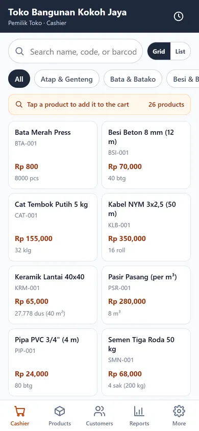

# Kokoh App Bangunan

**Aplikasi kasir (POS) offline untuk toko bangunan / material.**

Dua bahasa (English default + Indonesia) · Stok multi-satuan · HPP per satuan dasar · Piutang & jatuh tempo · Surat jalan · Shift kas · Laporan · Manajer database (simpan/muat/bagikan)

[](#)
[-blue)](#)
[-orange)](#)
[](#)

</div>

---

## Daftar Isi

1. [Ringkasan](#1-ringkasan)
2. [Fitur](#2-fitur)
3. [Tangkapan Layar](#3-tangkapan-layar)
4. [Teknologi](#4-teknologi)
5. [Persyaratan](#5-persyaratan)
6. [Instalasi & Menjalankan](#6-instalasi--menjalankan)
7. [Build Android (APK / AAB)](#7-build-android-apk--aab)
8. [Struktur Folder](#8-struktur-folder)
9. [Arsitektur & Alur Data](#9-arsitektur--alur-data)
10. [Database](#10-database)
11. [Daftar Rute](#11-daftar-rute)
12. [Referensi Fungsi](#12-referensi-fungsi)
13. [Panduan Pemakaian](#13-panduan-pemakaian)
14. [Pengujian](#14-pengujian)
15. [Troubleshooting](#15-troubleshooting)
16. [Rilis & Lisensi](#16-rilis--lisensi)

---

## 1. Ringkasan

Kokoh App Bangunan adalah aplikasi **kasir offline** yang dirancang khusus untuk toko bangunan /
material. Berbeda dari aplikasi kasir umum, Kokoh memahami bahwa semen dijual per **sak** tapi
distok per **kg**, keramik dijual per **dus** tapi dihitung per **m²**, dan bata dijual per
**buah** tapi dibeli per **pak**.

Semua data (produk, transaksi, stok, piutang, shift, pengguna) disimpan **di dalam perangkat**
sebagai database SQLite yang dijalankan lewat WebAssembly. Tidak ada server, tidak ada login
online, tidak ada langganan — aplikasi tetap berjalan penuh tanpa sinyal.

| | |
| --- | --- |
| **Nama aplikasi** | Kokoh App Bangunan |
| **Package / applicationId** | `id.aksisoft.kokoh` |
| **Versi** | `1.1.1` (versionCode `4`) |
| **minSdk** | 24 — Android 7.0 Nougat |
| **targetSdk / compileSdk** | 36 — Android 16 |
| **Ukuran terpasang** | ± 5,8 MB (APK universal) |
| **Bahasa antarmuka** | English (default) · Bahasa Indonesia |
| **Mata uang** | Rupiah (tanpa desimal) |
| **Izin Android** | hanya `INTERNET` (dipakai untuk membuka tautan WhatsApp) |

---

## 2. Fitur

### 2.1 Kasir (POS)

- Pencarian produk berdasarkan **nama, SKU, atau barcode**; filter per kategori dan produk favorit.
- Keranjang dengan ubah qty, ganti satuan jual (sak ↔ kg, dus ↔ m², pak ↔ buah),
  ubah harga satuan per item (nego), serta harga otomatis mengikuti **tier harga**
  pelanggan (Eceran / Grosir / Kontraktor).
- Diskon nota dan biaya kirim bisa diisi dari keranjang.
- Pembayaran: **Tunai, Transfer, Tempo, DP**. Numpad besar + tombol uang cepat
  (Rp 50rb / 100rb / 200rb / 500rb), tombol **Pas**, dan hitung kembalian otomatis.
- **Tempo / kasbon**: pilih pelanggan, tentukan jatuh tempo (7/14/30/60 hari), sisa masuk piutang.
- Nomor nota otomatis: `INV-YYYYMMDD-0001`.
- Nota PDF (A5) bisa dibagikan / dicetak; tombol **Kirim ke WhatsApp** membuat pesan tagihan siap kirim.
- **Surat jalan** dengan alamat kirim + nama sopir, dan status pengiriman
  (Belum dikirim → Dalam perjalanan → Diterima).
- Retur barang (opsional mengembalikan stok) dan pembatalan transaksi (stok dikembalikan, tercatat di audit log).

### 2.2 Produk & Stok

- Satu produk bisa punya **banyak satuan** dengan faktor konversi (`1 sak = 50 kg`, `1 dus = 1,44 m²`).
- **HPP disimpan per satuan dasar** sehingga laba dihitung benar walau dijual dalam satuan berbeda.
- Harga jual per satuan × per tier (Eceran / Grosir / Proyek).
- Stok minimum + daftar **stok menipis**, nilai stok total, dan stok opname (penyesuaian) dengan catatan.
- Riwayat mutasi stok per produk (`STOK_AWAL`, `PENJUALAN`, `PEMBELIAN`, `RETUR`, `PENYESUAIAN`).

### 2.3 Pelanggan & Piutang

- Data pelanggan: telepon/WA, alamat, nama proyek, tier harga, limit kredit, catatan.
- Tab **Piutang**: daftar nota tempo yang belum lunas, umur jatuh tempo, total piutang.
- Pembayaran piutang **sebagian atau penuh** langsung dari daftar piutang.
- Pengingat tagihan lewat **WhatsApp** (template otomatis berisi nomor nota, sisa, dan jatuh tempo).

### 2.4 Pembelian (Supplier)

- Catat barang masuk: pilih supplier, pilih produk, qty & harga beli per satuan beli.
- Stok bertambah otomatis dan **HPP produk diperbarui** mengikuti harga beli terakhir.
- Pembayaran **Lunas / Hutang / Setengah**, dengan jatuh tempo dan daftar hutang supplier.

### 2.5 Kas & Shift

- Buka kas dengan modal awal, catat **kas masuk / kas keluar** berkategori
  (operasional, bensin, gaji, setor pemilik, …).
- Tutup kas: bandingkan **kas sistem vs kas fisik**, hitung **selisih** lebih/kurang.
- Riwayat shift yang sudah ditutup.

### 2.6 Laporan

- Ringkasan periode: Hari ini / Kemarin / 7 hari / Bulan ini.
- Omzet, **laba kotor**, jumlah transaksi, item terjual, kas masuk/keluar, total piutang, nilai stok.
- Grafik penjualan harian dan daftar produk terlaris.

### 2.7 Lainnya

- Profil toko (nama, alamat, telepon, footer nota, PPN, pembulatan).
- Pengguna & PIN dengan peran **OWNER / ADMIN / KASIR**.
- **Backup** database ke file dan **restore** dari file.
- **Manajer Database**: simpan database bernama, muat ulang, upload file `.db`, dan bagikan (Telegram / Google Drive / File Manager / WhatsApp).
- Data 100 % lokal — bisa dipindah HP dengan backup/restore.

### 2.8 Dua Bahasa & Format Angka

- **English adalah bahasa default**; pindah ke **Bahasa Indonesia** lewat
  *More → Databases → Language* (atau *Lainnya → Database → Bahasa*).
- Semua layar, nota PDF, surat jalan, dan template WhatsApp ikut bahasa aktif.
- Angka & tanggal mengikuti bahasa:
  | | English | Indonesia |
  | --- | --- | --- |
  | Angka | `1,250,000` | `1.250.000` |
  | Desimal | `2.5` | `2,5` |
  | Tanggal | `Nov 12, 2026` | `12 Nov 2026` |
- Pilihan bahasa tersimpan di perangkat dan tetap aktif setelah aplikasi ditutup.

---

## 3. Tangkapan Layar

| Kasir | Keranjang | Pembayaran (Tempo) |
| :---: | :---: | :---: |
|  | 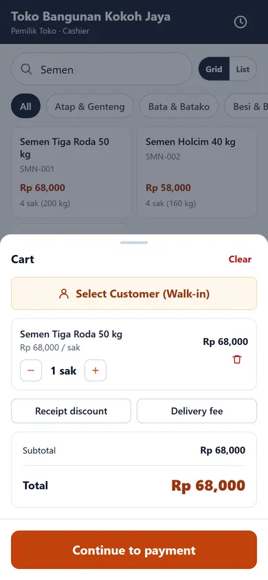 | 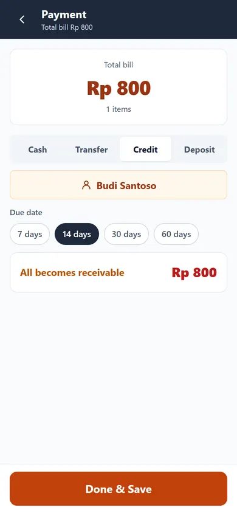 |

| Transaksi Berhasil | Detail Transaksi | Produk |
| :---: | :---: | :---: |
| 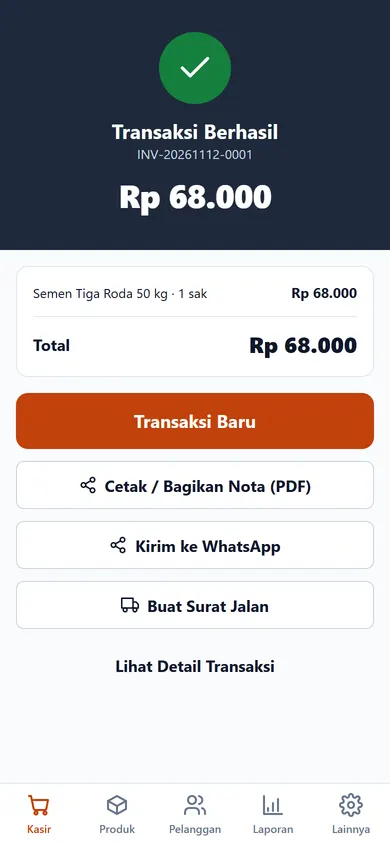 | 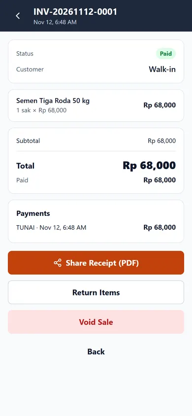 | 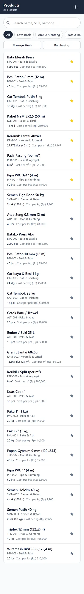 |

| Stok | Piutang | Pembelian |
| :---: | :---: | :---: |
| 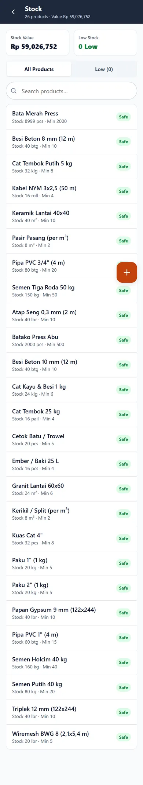 | 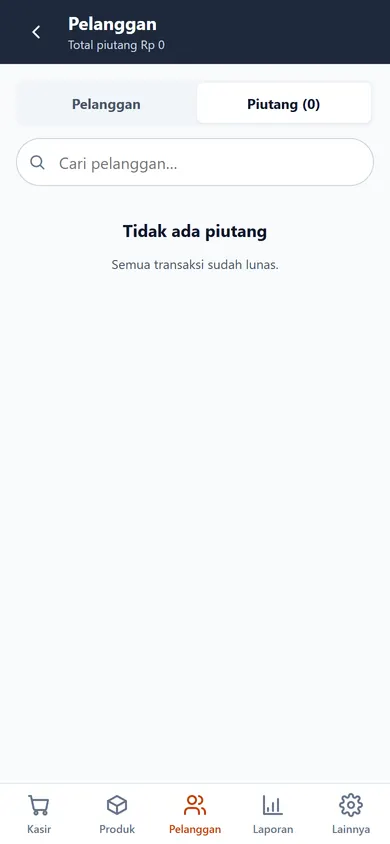 | 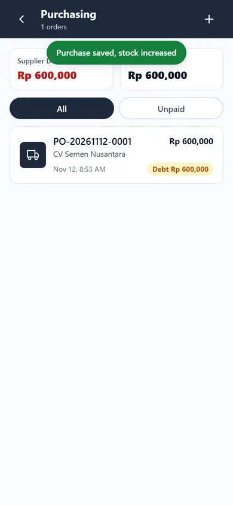 |

| Kas & Shift | Laporan | Surat Jalan |
| :---: | :---: | :---: |
| 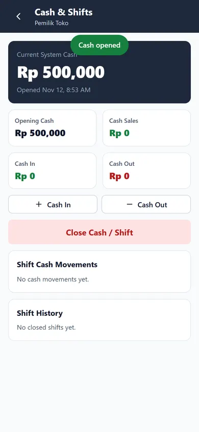 | 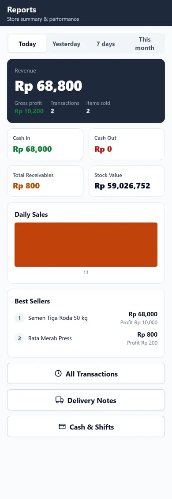 | 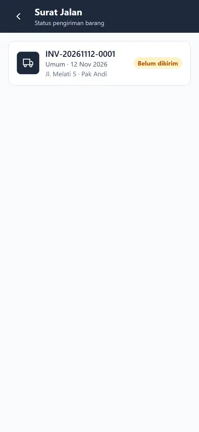 |

| Pengaturan | Database |
| :---: | :---: |
| 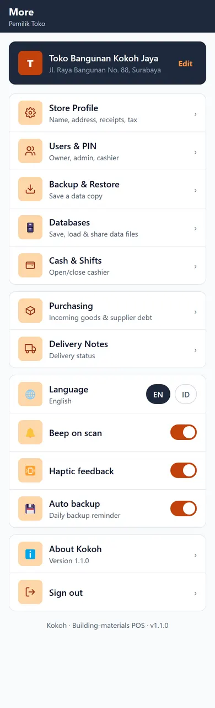 | 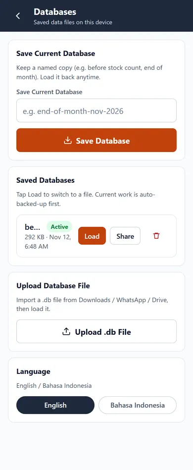 |

> Tangkapan layar memakai UI **English (default)**. Pilih
> *Bahasa Indonesia* untuk antarmuka berbahasa Indonesia.

---

## 4. Teknologi

| Lapisan | Teknologi | Versi | Dipakai untuk |
| --- | --- | --- | --- |
| UI | **React** | 19.3 | Seluruh komponen antarmuka |
| Bahasa | **TypeScript** | 7.0 | Strict mode, `noUnusedLocals`, `verbatimModuleSyntax` |
| Build tool | **Vite** | 8.3 | Dev server & bundling produksi |
| Routing | **react-router-dom** (HashRouter) | 7.18 | Navigasi antar layar, aman untuk WebView |
| State | **Zustand** | 5.1 | Sesi login, keranjang, toast |
| Database | **sql.js** (SQLite → WebAssembly) | 1.16 | Database relasional penuh, 100 % offline |
| Persistensi | **IndexedDB** (web) / **@capacitor/filesystem** (Android) | — | Menyimpan file database `.sqlite` |
| Shell Android | **Capacitor** | 8.6 | Membungkus web app menjadi APK/AAB |
| Plugin | `@capacitor/app`, `browser`, `filesystem`, `haptics`, `preferences`, `share`, `status-bar` | 8.x | Back button, buka WhatsApp, simpan file, getar, bagikan, status bar |
| PDF | **jsPDF** + **jspdf-autotable** | 4.2 / 5.0 | Nota & surat jalan A5 |
| Lint | **oxlint** | 1.90 | Pemeriksaan kode cepat |
| Aset | **@capacitor/assets** | 4.0 | Generate ikon & splash Android dari `assets/` |

Struktur database, tipe data, dan seluruh query berada di `src/lib/` — tidak ada ORM, sehingga
mudah diaudit dan dioptimalkan untuk perangkat kelas bawah.

---

## 5. Persyaratan

**Untuk menjalankan / membangun aplikasi**

| Kebutuhan | Versi | Catatan |
| --- | --- | --- |
| Node.js | ≥ 20 (diuji 22.20) | `npm` 10+ |
| JDK | **21** | Capacitor 8 tidak bisa build dengan JDK 17 |
| Android SDK | Platform 36 + Build-Tools 36 | `ANDROID_HOME` harus di-set |
| Gradle | dibundel (`android/gradlew`) | tidak perlu install manual |

> Di mesin pengembangan ini JDK 21 ada di `C:\Program Files\Android\Android Studio\jbr`
> dan Android SDK di `E:\Android\LocalAndroid\Sdk`.

**Untuk memakai aplikasi**

- Android 7.0 (API 24) ke atas, RAM ≥ 2 GB.
- Tidak butuh internet kecuali untuk membuka tautan WhatsApp.

---

## 6. Instalasi & Menjalankan

```bash
# 1. Ambil kode
git clone https://github.com/aksisoftsby/apk-sistemkasir-bangunan.git
cd apk-sistemkasir-bangunan

# 2. Pasang dependensi
npm install

# 3. Jalankan mode pengembangan (browser)
npm run dev
# → http://127.0.0.1:5173

# 4. Build produksi (web)
npm run build      # tsc -b && vite build → folder dist/

# 5. Cek hasil build produksi
npm run preview
```

### Perintah npm

| Perintah | Fungsi |
| --- | --- |
| `npm run dev` | Dev server Vite + HMR |
| `npm run build` | Type-check (`tsc -b`) lalu bundling ke `dist/` |
| `npm run preview` | Menyajikan `dist/` secara lokal (uji hasil produksi) |
| `npm run lint` | Menjalankan `oxlint` |

### Aktivasi lisensi / login pertama

Saat pertama dibuka, aplikasi menampilkan **Setup Toko**:

1. Isi nama toko (wajib), alamat, dan telepon.
2. Isi nama pemilik dan **PIN 4–6 digit** (dua kali).
3. Tekan **Mulai Gunakan Kokoh** → data contoh (26 produk, 15 satuan, 10 kategori,
   3 supplier, 3 pelanggan) otomatis dibuat.
4. Login memakai PIN tersebut. PIN disimpan sebagai hash (tidak pernah plain text).

---

## 7. Build Android (APK / AAB)

### 7.1 Sekali saja — inisialisasi platform

```bash
npm run build
npx cap add android          # membuat folder android/
npx cap sync android         # menyalin dist/ + plugin ke project Android
```

### 7.2 Build debug APK (untuk uji di HP)

```bash
cd android
./gradlew assembleDebug
# hasil: android/app/build/outputs/apk/debug/app-debug.apk
```

### 7.3 Build release bertanda tangan

Siapkan `android/keystore.properties` (tidak di-commit ke git):

```properties
storeFile=keystore/tukangdigital.keystore
storePassword=********
keyAlias=tukangdigital
keyPassword=********
```

Lalu:

```powershell
$env:JAVA_HOME='C:\Program Files\Android\Android Studio\jbr'
$env:ANDROID_HOME='E:\Android\LocalAndroid\Sdk'
cd android
.\gradlew.bat bundleRelease assembleRelease
```

| Keluaran | Path | Dipakai untuk |
| --- | --- | --- |
| **AAB** | `android/app/build/outputs/bundle/release/app-release.aab` | Upload ke Google Play Console |
| **APK** | `android/app/build/outputs/apk/release/app-release.apk` | Instal langsung / bagi ke tester |

Verifikasi tanda tangan:

```powershell
& "$env:JAVA_HOME\bin\java.exe" -jar "$env:ANDROID_HOME\build-tools\36.0.0\lib\apksigner.jar" `
  verify --verbose --print-certs android\app\build\outputs\apk\release\app-release.apk

& "$env:JAVA_HOME\bin\jarsigner.exe" -verify release\KokohAppBangunan-1.1.1-release.aab
```

### 7.4 Naikkan versi setiap rilis

`android/app/build.gradle`:

```gradle
versionCode 5          // WAJIB naik setiap upload ke Play (tidak boleh sama/mundur)
versionName "1.1.2"
```

### 7.5 Ikon & splash

```powershell
node scripts/gen-assets.cjs              # logo.webp → assets/icon-*.png + splash
npx @capacitor/assets generate --android # → semua densitas mipmap & drawable
```

Panduan lengkap (keystore, Play Console, kebijakan target API 36):
**[docs/ANDROID-BUILD.md](docs/ANDROID-BUILD.md)**

---

## 8. Struktur Folder

```
apk-sistemkasir-bangunan/
├── README.md                  # dokumen ini
├── RELEASE.md                 # catatan rilis 1.1.1 (hash, sertifikat, ukuran)
├── package.json
├── vite.config.ts             # base './' agar aman di WebView
├── capacitor.config.ts        # appId id.aksisoft.kokoh, webDir dist
├── index.html
│
├── public/
│   └── assets/                # logo.webp, hero-banner.webp, onboarding.webp, promo-banner.webp
│
├── store-assets/              # grafik khusus Play Store (tidak ikut APK)
│   ├── feature-graphic.jpg
│   └── banner.webp
│
├── assets/                    # sumber ikon/splash untuk @capacitor/assets
│   ├── icon-only.png
│   ├── icon-foreground.png
│   ├── icon-background.png
│   ├── splash.png
│   └── splash-dark.png
│
├── docs/
│   ├── FUNCTIONS.md           # referensi semua fungsi & komponen
│   ├── DATABASE.md            # skema 28 tabel + relasi
│   ├── ANDROID-BUILD.md       # build, signing, Play Console
│   ├── USER-GUIDE.md          # panduan pemakaian harian
│   └── screenshots/           # gambar untuk README (WebP)
│
├── scripts/
│   ├── gen-assets.cjs         # buat ikon adaptif + splash dari logo
│   └── gen-screenshots.cjs    # kompres tangkapan layar jadi WebP
│
├── release/                   # artefak siap edar
│   ├── KokohAppBangunan-1.1.1-release.aab
│   └── KokohAppBangunan-1.1.1-release.apk
│
├── src/
│   ├── main.tsx               # entry React
│   ├── App.tsx                # router, gate setup/login, TabBar
│   │
│   ├── lib/                   # ★ inti aplikasi (tanpa React)
│   │   ├── types.ts           # semua interface & tipe domain
│   │   ├── schema.ts          # DDL SQLite + SCHEMA_VERSION
│   │   ├── seed.ts            # data awal: 25 produk, satuan, kategori, supplier
│   │   ├── db.ts              # init sql.js, persist, transaksi, useDbVersion
│   │   ├── repo.ts            # seluruh operasi baca/tulis (produk, penjualan, …)
│   │   ├── report.ts          # agregasi laporan & stok
│   │   ├── format.ts          # rupiah, qty, tanggal, jatuh tempo
│   │   ├── id.ts              # uid, timestamp, hash & verifikasi PIN
│   │   ├── receipt.ts         # nota & surat jalan PDF, share, WhatsApp
│   │   └── backup.ts          # backup / restore .sqlite
│   │
│   ├── stores/                # state global Zustand
│   │   ├── session.ts         # user login + shift aktif
│   │   ├── cart.ts            # keranjang (persisted)
│   │   └── toast.ts           # notifikasi
│   │
│   ├── components/
│   │   ├── ui.tsx             # AppBar, BottomSheet, Numpad, dll.
│   │   └── icons.tsx          # 24 ikon SVG inline
│   │
│   ├── features/              # satu folder = satu domain layar
│   │   ├── auth/              # SetupScreen, LoginScreen
│   │   ├── pos/               # Pos, Cart, Payment, Success, History, Detail, Delivery
│   │   ├── products/          # ProductList, ProductForm, Stock
│   │   ├── customers/         # CustomerList, CustomerDetail
│   │   ├── purchase/          # PurchaseList, PurchaseForm
│   │   ├── shift/             # ShiftScreen (kas masuk/keluar/tutup)
│   │   ├── reports/           # ReportsScreen
│   │   └── settings/          # Settings, StoreSettings, Users, Backup
│   │
│   └── styles/
│       └── global.css         # design token + seluruh komponen CSS
│
└── android/                   # project native Capacitor (di-generate)
    ├── app/build.gradle       # applicationId, versi, signingConfig
    ├── keystore.properties    # (lokal, tidak di-commit)
    ├── keystore/*.keystore    # (lokal, tidak di-commit)
    └── variables.gradle       # compileSdk 36 / targetSdk 36 / minSdk 24
```

### Peta folder → tanggung jawab

| Folder | Isi | Aturan |
| --- | --- | --- |
| `src/lib/` | Logika non-UI | Tidak boleh mengimpor React (kecuali hook di `db.ts`) |
| `src/stores/` | State lintas layar | Hanya Zustand, tanpa query SQL |
| `src/components/` | Komponen presentasional | Tidak tahu domain bisnis |
| `src/features/<domain>/` | Layar per domain | Boleh memanggil `lib/repo` & `stores` |
| `android/` | Hasil `npx cap add android` | Jangan edit `assets/public` manual — pakai `cap sync` |

---

## 9. Arsitektur & Alur Data

```
┌──────────────────────────────────────────────────────────────┐
│  React (features/*)                                          │
│    │  baca/tulis lewat fungsi repo                           │
│    ▼                                                         │
│  src/lib/repo.ts  ──►  src/lib/db.ts  ──►  sql.js (SQLite)   │
│    │                        │                   │            │
│    │                        │ notifyChange()    │ export()   │
│    │                        ▼                   ▼            │
│    │                 useDbVersion()      IndexedDB (web)     │
│    │                 (re-render)         Filesystem (Android)│
│    ▼                                                         │
│  Zustand stores (session, cart, toast)                       │
└──────────────────────────────────────────────────────────────┘
```

**Siklus hidup database**

1. `initDb()` dipanggil sekali di `App.tsx`. Ia:
   - memuat `sql-wasm.wasm` (di-bundel Vite, 688 KB),
   - membaca file `kokoh.sqlite` dari IndexedDB (web) atau `Directory.Data` (Android),
   - menjalankan `SCHEMA_SQL` (idempoten `CREATE TABLE IF NOT EXISTS`),
   - mengisi data awal bila database masih kosong.
2. Setiap operasi tulis di-`run()` lalu `notifyChange()` menaikkan versi global.
   Komponen yang memakai `useDbVersion()` otomatis me-render ulang dengan data terbaru.
3. Penulisan file dilakukan **debounce** (`flushDb()`), plus dipaksa saat aplikasi
   di-background (`useAutoSaveOnHide`) agar tidak ada data hilang.
4. Transaksi multi-tabel (penjualan, pembelian, retur, tutup shift) memakai
   `begin() / commit() / rollback()` sehingga stok dan keuangan tidak pernah setengah jadi.

**Kenapa sql.js + persistensi sendiri?**

- SQLite asli memberi kemampuan SQL penuh (JOIN, agregasi, indeks) tanpa server.
- Hanya satu file database → backup/restore cukup copy file.
- Tidak butuh plugin SQLite native, sehingga build Android lebih sederhana dan
  aplikasi bisa diuji sepenuhnya di browser.

---

## 10. Database

**28 tabel**, tanpa foreign key constraint keras (integritas dijaga di `repo.ts` agar
migrasi & restore tetap mudah). Daftar lengkap kolom, tipe, dan relasi ada di
**[docs/DATABASE.md](docs/DATABASE.md)**.

| Kelompok | Tabel |
| --- | --- |
| Master | `store_profile`, `users`, `categories`, `units`, `price_tiers` |
| Produk & stok | `products`, `product_units`, `product_prices`, `stock_balances`, `stock_movements` |
| Penjualan | `sales`, `sale_items`, `sale_payments`, `sale_returns`, `sale_return_items`, `deliveries` |
| Pembelian | `purchases`, `purchase_items`, `purchase_payments` |
| Keuangan | `cash_shifts`, `cash_transactions`, `receivable_payments` |
| Lain-lain | `customers`, `suppliers`, `held_orders`, `settings`, `audit_logs`, `schema_meta` |

**Prinsip penting**

- Semua nominal uang = **INTEGER rupiah** (tanpa desimal, tanpa float error).
- Semua qty stok = **satuan dasar** (kg, m², buah, batang, …) bertipe `REAL`.
- `sales.sisa > 0` berarti piutang; `sales.status` ∈ `LUNAS | TEMPO | DP | BATAL`.
- Penghapusan master data memakai **soft delete** (`deleted_at`), transaksi memakai `BATAL`
  agar laporan historis tetap konsisten.
- `audit_logs` mencatat aksi sensitif (pembatalan, retur, tutup shift, restore backup).

---

## 11. Daftar Rute

Menggunakan `HashRouter` (`#/pos`), sehingga deep-link aman di WebView Android.

| Rute | Layar | Keterangan |
| --- | --- | --- |
| `/setup` | `SetupScreen` | Setup toko pertama kali |
| `/login` | `LoginScreen` | Login PIN |
| `/pos` | `PosScreen` | **Tab** Kasir: katalog + keranjang |
| `/pos/payment` | `PaymentScreen` | Metode bayar, tempo, DP, kembalian |
| `/pos/success/:id` | `SuccessScreen` | Nota, PDF, WhatsApp, surat jalan |
| `/pos/history` | `HistoryScreen` | Riwayat transaksi + filter status |
| `/pos/history/:id` | `TransactionDetailScreen` | Detail, retur, batal, kirim tagihan |
| `/pos/delivery` | `DeliveryScreen` | Daftar surat jalan & ubah status |
| `/products` | `ProductListScreen` | **Tab** Produk |
| `/products/new` · `/products/:id` | `ProductFormScreen` | Tambah / ubah produk |
| `/stock` | `StockScreen` | Stok, nilai stok, opname |
| `/customers` | `CustomerListScreen` | **Tab** Pelanggan + Piutang |
| `/customers/:id` | `CustomerDetailScreen` | Riwayat & tagihan pelanggan |
| `/reports` | `ReportsScreen` | **Tab** Laporan |
| `/settings` | `SettingsScreen` | **Tab** Lainnya |
| `/settings/store` | `StoreSettingsScreen` | Profil toko |
| `/settings/users` | `UsersScreen` | Pengguna & PIN |
| `/settings/backup` | `BackupScreen` | Backup / restore |
| `/purchase` · `/purchase/new` | `PurchaseScreen` / `PurchaseFormScreen` | Pembelian supplier |
| `/shift` | `ShiftScreen` | Kas & shift |
| `*` | → `/pos` | Fallback |

TabBar hanya tampil di lima rute tab (`/pos`, `/products`, `/customers`, `/reports`, `/settings`),
sedangkan sub-layar tampil penuh dengan tombol back.

---

## 12. Referensi Fungsi

Semua fungsi publik didokumentasikan (parameter, nilai balik, efek samping) di
**[docs/FUNCTIONS.md](docs/FUNCTIONS.md)**. Ringkasan modul:

| Modul | Jumlah export | Isi |
| --- | --- | --- |
| `lib/db.ts` | 17 | Inisialisasi sql.js, persistensi, helper SQL, transaksi, hook versi |
| `lib/repo.ts` | 47 | CRUD master data, penjualan, pembelian, piutang, shift, pengguna |
| `lib/report.ts` | 8 | Agregasi laporan, nilai stok, produk terlaris, mutasi stok |
| `lib/format.ts` | 15 | Format rupiah/qty/tanggal, parse input, umur jatuh tempo |
| `lib/receipt.ts` | 7 | Nota & surat jalan PDF, share, tautan WhatsApp |
| `lib/backup.ts` | 3 | Backup / restore database |
| `lib/id.ts` | 4 | UID, timestamp ISO, hash & verifikasi PIN |
| `lib/schema.ts` | 2 | DDL + versi skema |
| `lib/seed.ts` | 8 | Data awal & profil default |
| `stores/*` | 3 store + 5 helper | Sesi, keranjang, toast |
| `components/ui.tsx` | 13 | AppBar, BottomSheet, Modal, Numpad, Money, dll. |
| `components/icons.tsx` | 24 | Ikon SVG inline (tanpa dependensi) |

Contoh pemakaian:

```ts
import { listProducts, createSale } from './lib/repo';
import { useDbVersion } from './lib/db';

const ver = useDbVersion();                       // re-render saat data berubah
const produk = useMemo(() => listProducts({ search: 'semen' }), [ver]);

createSale({ /* … */ }, userId, shiftId);         // stok & kas ikut ter-update
```

---

## 13. Panduan Pemakaian

Panduan harian (buka toko → jualan → tutup kas) ada di
**[docs/USER-GUIDE.md](docs/USER-GUIDE.md)**. Ringkasnya:

1. **Pagi** — buka menu **Lainnya → Kas & Shift → Buka Kas**, isi modal laci.
2. **Jualan** — tab **Kasir** → cari produk → pilih satuan & qty → **Bayar** →
   pilih metode → **Selesai & Simpan** → cetak nota / kirim WhatsApp / buat surat jalan.
3. **Barang datang** — **Lainnya → Pembelian → +** → pilih supplier & barang →
   pilih Lunas/Hutang → simpan (stok & HPP otomatis).
4. **Kasbon** — saat bayar pilih **Tempo**, pilih pelanggan + jatuh tempo.
   Penagihan di **Pelanggan → Piutang** (tombol Bayar / WhatsApp).
5. **Sore** — **Kas & Shift → Tutup Kas**, masukkan uang fisik, periksa selisih.
6. **Rutin** — **Lainnya → Backup** dan simpan file `.sqlite` ke Google Drive/WhatsApp.

---

## 14. Pengujian

Aplikasi diuji end-to-end di browser (viewport 390×844, Chrome headless) memakai skrip
Puppeteer di luar repo. Skenario yang lulus:

- setup toko + login PIN, sesi bertahan setelah reload
- tambah produk, ubah produk, stok opname, produk baru langsung muncul di kasir
- transaksi tunai penuh (kembalian), transaksi tempo + DP, pembayaran piutang sebagian & penuh
- pembelian supplier (stok & HPP berubah), hutang supplier
- shift: buka kas → kas keluar → tutup kas dengan selisih
- surat jalan dibuat dari layar sukses + perubahan status pengiriman
- nota PDF ter-download, tombol WhatsApp menghasilkan tautan `wa.me`
- laporan: omzet, laba kotor, piutang, nilai stok akurat
- backup database berhasil dibuat
- **Dua bahasa**: English default (setup, tab kasir, pembayaran, transaksi berhasil),
  pindah ke Bahasa Indonesia dan tetap aktif setelah reload
- **Manajer Database**: simpan database bernama, muncul di daftar, muat ulang
- **0 error konsol** pada build produksi

Pemeriksaan statis:

```bash
npm run build   # TypeScript strict — harus 0 error
npm run lint    # oxlint
```

---

## 15. Troubleshooting

| Gejala | Penyebab | Solusi |
| --- | --- | --- |
| `Unsupported class file major version` / build gagal | Gradle memakai JDK 17 | Set `JAVA_HOME` ke JDK 21 (JBR Android Studio) |
| `SDK location not found` | `ANDROID_HOME` kosong | Set `ANDROID_HOME` ke folder SDK |
| `Gradle build daemon disappeared` | RAM kurang (mesin kecil) | Tutup aplikasi lain; `gradle.properties` sudah dibatasi `-Xmx1280m`, `workers.max=2` |
| Layar putih setelah `cap sync` | `dist/` belum di-build | `npm run build` lalu `npx cap sync android` |
| Data hilang setelah update | APK berbeda applicationId / restore belum dilakukan | Pakai package yang sama + restore dari backup `.sqlite` |
| Aplikasi crash saat dibuka di emulator | Emulator butuh RAM/GPU besar | Uji di HP fisik; emulator API 36 sering gagal di mesin 8 GB |
| Nota PDF tidak muncul di Android | Folder cache belum siap | Coba lagi setelah transaksi berikutnya; file disimpan di `Directory.Cache` |
| Warna/ikon lama masih muncul | Launcher cache | Uninstall lalu install ulang APK |

---

## 16. Rilis & Lisensi

**Artefak rilis 1.1.1**

| File | Ukuran | SHA-256 |
| --- | --- | --- |
| `release/KokohAppBangunan-1.1.1-release.aab` | 5,5 MB | `B3763FA15918E2FC9492E3362BA246F315469811C4573BC7635D2B98EF407CD5` |
| `release/KokohAppBangunan-1.1.1-release.apk` | 5,7 MB | `3138015C779772F70D5FC55A3507E9070AB43704A5AE3161268EEB143E7A8CD8` |

- Ditandatangani `CN=DoniMuslimin, OU=TukangDigital, O=TukangDigital` (RSA, berlaku s/d 2044).
- Detail sertifikat, hash, dan langkah rilis: **[RELEASE.md](RELEASE.md)**.
- `keystore` **tidak disertakan** di repo demi keamanan — simpan di tempat aman,
  tanpa file itu aplikasi tidak bisa di-update di Play Store.

**Lisensi**

Kode ini milik **AKSISOFT / TukangDigital**. Data contoh (26 produk bangunan, supplier,
pelanggan) hanya untuk demonstrasi dan bisa diubah/dihapus dari aplikasi.

**Kredit**

- Ikon & splash: dibuat dari logo Kokoh (generate aset AI, diproses `sharp`).
- Font: Inter (system fallback bila tidak tersedia).
- Terima kasih kepada komunitas open source: React, Vite, Capacitor, sql.js, Zustand, jsPDF.
