# Tutorial Lengkap — Kokoh App Bangunan

Panduan pemakaian **Kokoh App Bangunan v1.2.0** dari instalasi sampai tutup toko.
Tutorial ini menjelaskan **setiap layar, setiap tombol, dan setiap alur navigasi klik**,
termasuk layar yang tidak terlihat di menu utama.

> **Konvensi penulisan**
>
> - Nama tombol ditulis **tebal** persis seperti yang tampil di aplikasi versi **English**
>   (bahasa default). Padanan Indonesia ditulis *miring* dalam tanda kurung bila berbeda jauh.
> - `→` berarti "lanjut ke langkah berikutnya".
> - `/pos`, `/settings/backup`, dan sejenisnya adalah **path halaman** (HashRouter).
>   Bisa dipakai untuk rujukan cepat; pengguna cukup menekan tombol seperti dijelaskan.
> - **Sheet** = panel yang muncul dari bawah layar. **Dialog** = kotak konfirmasi di tengah.
> - Semua data tersimpan **offline di perangkat**. Tidak ada server, tidak ada sinkronisasi.

---

## Daftar Isi

1. [Instalasi & pembukaan pertama](#1-instalasi--pembukaan-pertama)
2. [Setup awal toko](#2-setup-awal-toko-setup)
3. [Login & PIN](#3-login--pin-login)
4. [Navigasi utama & tab bar](#4-navigasi-utama--tab-bar)
5. [Kasir (Cashier)](#5-kasir-cashier-pos)
6. [Keranjang](#6-keranjang-cart-sheet)
7. [Pembayaran](#7-pembayaran-pospayment)
8. [Layar sukses & surat jalan](#8-layar-sukses--surat-jalan-possuccessid)
9. [Riwayat penjualan](#9-riwayat-penjualan-poshistory)
10. [Detail transaksi: retur & batal](#10-detail-transaksi-poshistoryid)
11. [Daftar surat jalan](#11-daftar-surat-jalan-posdelivery)
12. [Produk](#12-produk-products)
13. [Tambah / edit produk](#13-tambah--edit-produk-productsnew-productsid)
14. [Stok](#14-stok-stock)
15. [Pelanggan & piutang](#15-pelanggan--piutang-customers)
16. [Detail pelanggan](#16-detail-pelanggan-customersid)
17. [Pembelian](#17-pembelian-purchase)
18. [Kas & shift](#18-kas--shift-shift)
19. [Laporan](#19-laporan-reports)
20. [Pengaturan (More)](#20-pengaturan-more-settings)
21. [Profil toko](#21-profil-toko-settingsstore)
22. [Pengguna & PIN](#22-pengguna--pin-settingsusers)
23. [Backup & restore](#23-backup--restore-settingsbackup)
24. [Databases](#24-databases-settingsdatabases)
25. [Alur kerja harian](#25-alur-kerja-harian)
26. [Peta navigasi lengkap](#26-peta-navigasi-lengkap)
27. [Daftar tombol per layar](#27-daftar-tombol-per-layar)
28. [Troubleshooting & FAQ](#28-troubleshooting--faq)
29. [Tips & praktik terbaik](#29-tips--praktik-terbaik)

---

## 1. Instalasi & pembukaan pertama

1. Salin file **APK** `Kokoh App Bangunan` ke HP Android (WhatsApp, Google Drive, kabel USB, dsb.).
2. Ketuk file APK → bila muncul peringatan, izinkan **Install unknown apps** untuk aplikasi
   pengirim file (WhatsApp/Files), lalu ketuk **Install**.
3. Buka aplikasi **Kokoh App Bangunan**.

Saat pertama dibuka, layar splash muncul beberapa detik:

- Logo Kokoh, tulisan **Kokoh**, subjudul **Building-materials POS** *(POS material bangunan)*.
- Spinner berputar sementara database lokal disiapkan.
- Jika database gagal dimuat, muncul **Failed to load app** *(Gagal memuat aplikasi)*
  beserta keterangan error. Tutup paksa aplikasi lalu buka lagi; kalau tetap gagal,
  lihat [Troubleshooting](#28-troubleshooting--faq).

Karena belum ada profil toko, aplikasi otomatis membuka halaman **Setup** (`/setup`).
Instalasi tidak meminta login online, tidak meminta izin lokasi/kontak, dan bisa dipakai
tanpa kartu SIM.

---

## 2. Setup awal toko (`/setup`)

Layar setup hanya muncul **sekali** (saat database masih kosong). Isi datanya dengan benar
karena dipakai di struk, surat jalan, dan laporan.

### 2.1 Bagian "Store details"

| Kolom | Isi | Wajib |
| --- | --- | --- |
| **Store name \*** | Nama toko, mis. `Toko Bangunan Makmur` | Ya |
| **Address** | Alamat lengkap toko (tercetak di struk) | Tidak |
| **Phone** | Nomor telepon/WA toko, mis. `0812...` | Tidak |

### 2.2 Bagian "Owner account"

| Kolom | Isi | Catatan |
| --- | --- | --- |
| **Owner name** | Nama pemilik | Otomatis terisi `Store Owner` bila dikosongkan |
| **PIN (4-6 digits) \*** | PIN pemilik, 4–6 angka | Dipakai untuk login & membatalkan transaksi |
| **Repeat PIN \*** | Ulangi PIN yang sama | Harus identik |

### 2.3 Tombol

- **Start using Kokoh** *(Mulai pakai Kokoh)* — menyimpan profil toko + akun pemilik,
  lalu langsung masuk ke layar Kasir sebagai **Owner**.
- Teks kecil di bawah: **Data is stored locally on this device. Back up regularly.**
  *(Data tersimpan lokal di perangkat ini. Backup secara rutin.)*

### 2.4 Pesan validasi yang mungkin muncul

| Pesan | Penyebab | Tindakan |
| --- | --- | --- |
| **Store name is required** | Nama toko kosong | Isi **Store name \*** |
| **PIN must be at least 4 digits** | PIN < 4 angka | Isi minimal 4 angka |
| **PIN confirmation does not match** | Dua kolom PIN berbeda | Ketik ulang PIN yang sama |
| **Store is ready** (toast hijau) | Berhasil | Lanjut ke Kasir |

> Setelah setup, halaman ini tidak bisa dibuka lagi lewat menu. Profil toko tetap bisa
> diubah kapan saja di **More → Store Profile**.

---

## 3. Login & PIN (`/login`)

Login muncul saat aplikasi pertama kali dipakai setelah setup, setelah **Sign out**,
atau bila sesi tersimpan di perangkat tidak ada/terhapus. Selama belum sign out,
aplikasi biasanya langsung membuka Kasir.

### 3.1 Isi layar

- Logo, judul **Kokoh**, tagline **Building-materials POS**, dan tanggal hari ini.
- **Chip nama pengguna** — hanya muncul bila ada **lebih dari satu pengguna**.
  Ketuk nama untuk memilih akun; PIN otomatis dikosongkan.
- Teks **Sign in as {nama}** *(Masuk sebagai …)* atau **Enter PIN**.
- **6 titik PIN** — titik terisi sesuai jumlah angka yang diketik.
- **Numpad besar**:
  - `1`–`9` — memasukkan angka.
  - `C` — menghapus seluruh PIN.
  - `0` — memasukkan angka nol.
  - `⌫` — menghapus satu angka terakhir.
- **Forgot PIN? Ask the owner to reset it.** *(Lupa PIN? Minta pemilik mereset.)*

### 3.2 Cara masuk

1. Ketuk nama pengguna (bila ada beberapa akun).
2. Ketik PIN.
3. PIN diverifikasi **otomatis saat mencapai 4 digit**:
   - PIN benar → langsung masuk ke **Kasir** (`/pos`).
   - PIN 5–6 digit → lanjut mengetik sampai cocok.
   - PIN salah → setelah 6 digit muncul toast **Wrong PIN** dan PIN dikosongkan.

> **Keamanan:** tidak ada tombol "lupa PIN" otomatis. Pemilik harus masuk dengan akun
> Owner lalu mengganti PIN pengguna di **More → Users & PIN**. Jika PIN Owner hilang,
> satu-satunya jalan adalah restore database dari backup.

### 3.3 Sesudah login

- Aplikasi mengingat sesi di perangkat, jadi menutup aplikasi tidak selalu meminta PIN lagi.
- **Sign out** tersedia di **More → Sign out**.
- Bila profil toko terhapus (mis. setelah restore file kosong), aplikasi kembali ke `/setup`.

---

## 4. Navigasi utama & tab bar

Ada **5 tab** di bawah layar. Tab bar **hanya tampil di 5 halaman utama**; di halaman
detail/fitur, tab bar diganti tombol panah kembali.

| Tab | Ikon | Halaman | Fungsi |
| --- | --- | --- | --- |
| **Cashier** | keranjang | `/pos` | Jual barang, cari produk, buka keranjang |
| **Products** | kotak | `/products` | Daftar produk, tambah/edit, stok, pembelian |
| **Customers** | orang | `/customers` | Pelanggan & daftar piutang |
| **Reports** | grafik | `/reports` | Omzet, laba, produk terlaris |
| **More** | gerigi | `/settings` | Toko, pengguna, backup, bahasa, logout |

Cara berpindah:

- Ketuk tab → pindah halaman. Tab aktif ditandai warna & ikon terang.
- Di halaman non-tab muncul tombol **‹ Back** di kiri atas (AppBar) → kembali ke halaman sebelumnya.
- **Tombol back Android** juga berfungsi: kembali satu langkah bila ada riwayat.
- Route yang tidak dikenal otomatis diarahkan ke `/pos`.

**Halaman yang tidak punya tab** (harus lewat tombol): pembayaran, sukses, riwayat,
detail transaksi, surat jalan, form produk, stok, detail pelanggan, pembelian,
kas & shift, profil toko, pengguna, backup, databases, setup, login.

---

## 5. Kasir (Cashier) (`/pos`)

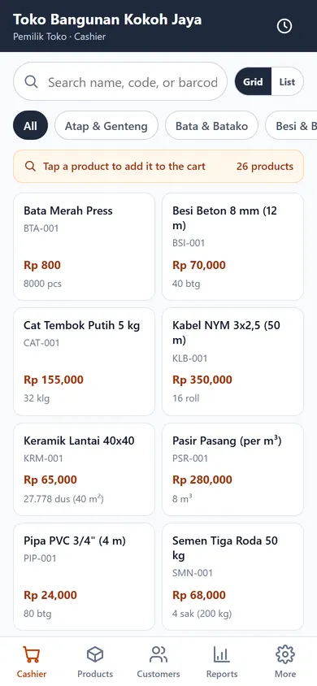

Ini layar yang paling sering dipakai. Semua penjualan dimulai dari sini.

### 5.1 App bar

| Elemen | Aksi |
| --- | --- |
| **Nama toko** (judul) | Menampilkan nama dari profil toko |
| **{nama kasir} · Cashier** | Menunjukkan siapa yang sedang login |
| **Ikon jam** (kanan atas) | Buka **Sale History** (`/pos/history`) |

### 5.2 Pencarian

- Ketuk kolom **Search name, code, or barcode…**
  *(Cari nama, kode, atau barcode…)* lalu ketik.
- Pencarian mencocokkan **nama produk, SKU, dan barcode** secara langsung.
- Hapus teks untuk menampilkan semua produk lagi.
- Bila tidak ada hasil: muncul ilustrasi + **No products found** dan
  **Try another keyword or add a new product.**

### 5.3 Tombol tampilan Grid / List

Di kanan kolom pencarian ada dua tombol kecil:

- **Grid** — kartu produk 2 kolom (nama, kode/kategori, harga, stok + badge).
- **List** — baris padat 1 kolom (lebih banyak produk terlihat sekaligus).

Pilihan disimpan di perangkat (`kokoh_pos_view_v1`) dan tetap sama saat aplikasi dibuka lagi.

### 5.4 Chip kategori

Baris chip yang bisa digeser ke samping:

- **All** *(Semua)* — tampilkan semua kategori.
- Chip nama kategori: **Semen & Beton**, **Bata & Batako**, **Keramik & Lantai**,
  **Cat & Finishing**, **Besi & Baja**, **Pipa & Plumbing**, **Kabel & Listrik**,
  **Paku & Alat**, **Pasir & Agregat**, **Atap & Genteng**.
- Ketuk satu kategori untuk memfilter; ketuk **All** untuk membatalkan filter.
- Filter kategori dan pencarian bisa aktif bersamaan.

### 5.5 Strip katalog

Saat **tidak ada pencarian & tidak ada filter kategori**, muncul strip abu-abu:

- Ikon kaca pembesar.
- Teks **Tap a product to add it to the cart** *(Ketuk produk untuk menambah ke keranjang)*.
- Jumlah produk, mis. **24 products**.

### 5.6 Kartu produk

Setiap kartu menampilkan:

- **Nama produk**.
- **SKU / barcode / nama kategori** (salah satu yang tersedia).
- **Harga** sesuai level harga pelanggan yang dipilih (Eceran/Grosir/Kontraktor).
- **Stok dalam satuan jual + konversi**, mis. `4 sak (200 kg)`.
- Badge hanya muncul bila perlu:
  - **Low stock** *(stok menipis)* — kuning.
  - **Out of stock** *(stok habis)* — merah.
- Di mode **List**, stok tampil sebagai baris kecil; di mode **Grid**, stok ada di bawah harga.

Ketuk kartu (di mana saja) → membuka **sheet produk**.

> Aplikasi **tidak memblokir** penjualan saat stok 0 atau kurang. Badge hanya peringatan.
> Stok bisa menjadi minus dan dikoreksi lewat **Manage Stock** atau opname.

### 5.7 Sheet produk

Muncul dari bawah, berisi:

| Elemen | Fungsi |
| --- | --- |
| Judul = nama produk | — |
| **Stock: {qty} {satuan}** | Stok saat ini dalam satuan dasar |
| Badge **Low stock** | Muncul bila qty yang dipilih melebihi stok |
| Label **Unit** + chip satuan | Pilih satuan jual: mis. `sak ×50`, `kg` |
| **Qty ({satuan})** | Pengatur jumlah |
| Tombol **−** | Kurangi 1 (satuan bulat) atau 0,5 (satuan desimal); minimum 1 atau 0,1 |
| Angka qty (tengah) | Ketuk → buka numpad **Amount** untuk ketik jumlah langsung |
| Tombol **+** | Tambah 1 atau 0,5 |
| **Unit price (Rp)** | Harga per satuan; bisa diedit untuk nego |
| Teks konversi | Mis. `2 sak = 100 kg`, muncul bila satuan ≠ satuan dasar |
| Tombol bawah **Add · Rp {subtotal}** | Masukkan ke keranjang |

Catatan:

- Mengubah satuan otomatis memuat harga tier pelanggan untuk satuan tersebut.
- Mengetuk **Add** menutup sheet dan menampilkan toast **Added to cart**.
- Menambah produk + satuan yang **sama** akan **menggabung qty** di baris keranjang,
  bukan membuat baris baru.

### 5.8 Footer keranjang (mengambang di atas tab bar)

Hanya muncul bila keranjang berisi minimal satu item:

- Badge jumlah, mis. **2 items** *(2 item)*.
- Badge nama pelanggan (bila sudah dipilih).
- **Total** besar di kanan.
- Tombol **Cart** *(Keranjang)* → buka sheet keranjang.
- Tombol **Pay** *(Bayar)* → langsung ke halaman pembayaran.

### 5.9 Sheet pilih pelanggan

Dibuka dari dalam keranjang (**Select Customer**) atau dari halaman pembayaran
(**Select Customer \***).

- Kolom **Search customers…** untuk mencari nama/nomor.
- Tombol **Walk-in customer** *(Pelanggan umum)* → mengosongkan pelanggan.
- Daftar pelanggan: avatar huruf awal, nama, nomor telepon/kode.
- Ketuk pelanggan → pelanggan terpasang, dan **proyek pelanggan otomatis terisi**
  ke nota (bila ada). Toast nama pelanggan muncul.

---

## 6. Keranjang (Cart sheet)

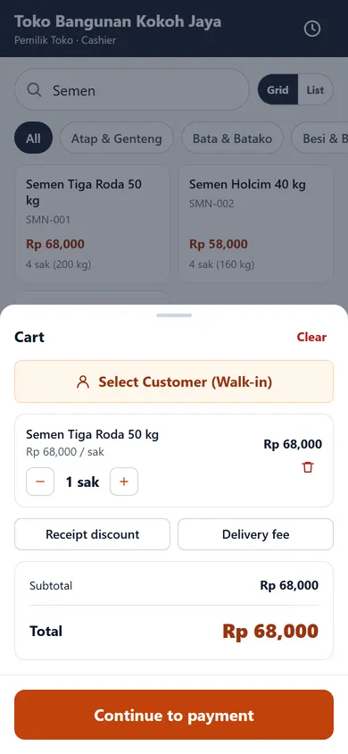

Dibuka dengan tombol **Cart**. Isinya dari atas ke bawah:

| Elemen | Aksi |
| --- | --- |
| **Cart** (judul) | — |
| **Clear** *(Kosongkan)* | Menghapus seluruh isi keranjang (tanpa konfirmasi) |
| **Select Customer (Walk-in)** | Buka sheet pilih pelanggan; berubah jadi nama pelanggan bila sudah dipilih |
| Baris item: nama + `Rp harga / satuan` | — |
| **−** | Kurangi qty (1 atau 0,5) |
| Angka qty + satuan | Ketuk → numpad **Edit quantity** |
| **+** | Tambah qty (1 atau 0,5) |
| **Rp subtotal** | Subtotal baris |
| Ikon **tempat sampah** | Hapus baris dari keranjang |
| **Receipt discount** | Buka numpad diskon nota (Rp). Nilai muncul di tombol, mis. `(-10.000)` |
| **Delivery fee** | Buka numpad biaya kirim (Rp) |
| **Subtotal** | Total sebelum diskon/pajak |
| **Discount** | Diskon nota (merah, bila ada) |
| **Tax** | PPN (bila tarif pajak > 0 di profil toko) |
| **Delivery fee** | Biaya kirim (bila diisi) |
| **Rounding** | Pembulatan (bila diaktifkan) |
| **Total** | Total akhir yang harus dibayar |
| **Continue to payment** | Tutup sheet → halaman pembayaran |

**Urutan perhitungan total:**

```text
subtotal   = jumlah subtotal semua baris
diskon     = min(diskon nota, subtotal)
setelah    = subtotal − diskon
pajak      = bulat(setelah × tarif PPN / 100)
kotor      = setelah + pajak + biaya kirim
total      = dibulatkan sesuai pengaturan pembulatan (0/100/500/1000)
```

**Catatan penting:**

- Keranjang **tersimpan otomatis** di perangkat. Menutup aplikasi tidak menghilangkan
  item yang belum dibayar.
- Harga satuan di keranjang **tidak bisa** diubah langsung; ubah di **sheet produk**
  sebelum menekan Add.
- Tombol **Continue to payment** nonaktif bila keranjang kosong.

---

## 7. Pembayaran (`/pos/payment`)

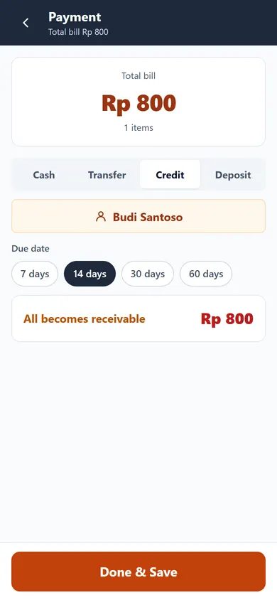

### 7.1 Ringkasan atas

- **Total bill** *(Total tagihan)* + nominal besar.
- Jumlah item, mis. **3 items** / **1 item**.

### 7.2 Pilih metode (Segmented)

| Tombol | Arti | Yang muncul |
| --- | --- | --- |
| **Cash** *(Tunai)* | Bayar penuh tunai | Kolom uang diterima + kembalian |
| **Transfer** | Transfer bank | Catatan konfirmasi transfer |
| **Credit** *(Tempo)* | Seluruhnya jadi piutang | Pilih pelanggan + jatuh tempo |
| **Deposit** *(DP)* | Uang muka sebagian | Pilih pelanggan + nominal DP + jatuh tempo |

### 7.3 Alur Cash (Tunai)

1. Metode **Cash** aktif secara default; nominal **Cash received** otomatis = total.
2. Ketuk **Edit** di kanan untuk mengubah uang diterima lewat numpad
   **Amount received** (ada tombol cepat Rp 50.000 / 100.000 / 200.000 / 500.000).
3. Atau ketuk chip:
   - **Exact** *(Pas)* — isi tepat sebesar total.
   - **Rp 50.000**, **Rp 100.000**, **Rp 200.000** — isi cepat.
4. Di bawah muncul salah satu:
   - **Change** *(Kembalian)* hijau = uang diterima − total.
   - **Short** *(Kurang)* merah = total − uang diterima.
5. Bila **Short** masih muncul, tombol simpan akan menolak dengan toast
   **Cash received is less than total**.

### 7.4 Alur Transfer

1. Pilih **Transfer**.
2. Baca catatan: **Record manual transfer payments. Make sure funds arrived before saving.**
3. Tidak ada input tambahan; nominal dianggap lunas sebesar total.
4. Ketuk **Done & Save** setelah dana benar-benar masuk.

### 7.5 Alur Credit (Tempo)

1. Pilih **Credit**.
2. Tombol **Select Customer \*** wajib diisi → buka sheet pelanggan.
   Tanpa pelanggan, simpan ditolak: **Select a customer for credit/deposit sales**.
3. Pilih **Due date** *(jatuh tempo)*: **7 days**, **14 days**, **30 days**, **60 days**.
4. Kartu **All becomes receivable** menampilkan seluruh total menjadi piutang.
5. **Done & Save** → transaksi tersimpan sebagai **Credit**, sisa masuk daftar piutang.

### 7.6 Alur Deposit (DP)

1. Pilih **Deposit**.
2. Pilih pelanggan (wajib).
3. Tentukan jatuh tempo (7/14/30/60 hari).
4. Isi **Deposit received**:
   - Ketuk **Edit** → numpad **Deposit amount**.
   - Atau chip **25%**, **50%**, **75%** dari total.
5. Kartu **Rest becomes receivable** menunjukkan sisa yang menjadi piutang.
6. DP 0 ditolak: **Deposit must be more than 0**.
7. **Done & Save**.

### 7.7 Simpan

- Tombol bawah: **Done & Save** *(Selesai & Simpan)*; berubah **Saving…** saat proses.
- Bila pelanggan punya **credit limit** dan sisa piutang melebihi limit, muncul
  peringatan **Over customer credit limit** — transaksi tetap bisa disimpan
  (hanya peringatan, bukan pemblokiran).
- Setelah sukses: toast **Sale saved**, keranjang dikosongkan, dan aplikasi pindah ke
  layar sukses (`/pos/success/:id`).

### 7.8 Pesan error pembayaran

| Pesan | Arti |
| --- | --- |
| **Cart is empty** | Keranjang kosong |
| **Select a customer for credit/deposit sales** | Credit/Deposit tanpa pelanggan |
| **Cash received is less than total** | Uang tunai kurang |
| **Deposit must be more than 0** | DP nol |
| **Save failed: …** | Gangguan penyimpanan (lihat Troubleshooting) |

---

## 8. Layar sukses & surat jalan (`/pos/success/:id`)

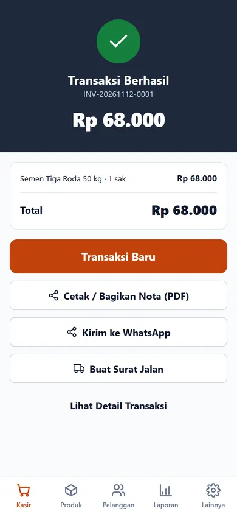

### 8.1 Bagian atas

- Lingkaran centang hijau + **Sale Complete** *(Transaksi berhasil)*.
- Nomor nota, mis. `INV-20261112-0007`.
- Total besar.
- Kartu rincian item (nama · qty satuan · subtotal) + **Total**.
- Bila ada sisa: **Balance due (due {tanggal})** dan nominal merah.

### 8.2 Tombol

| Tombol | Fungsi |
| --- | --- |
| **New Sale** *(Transaksi baru)* | Kembali ke Kasir dengan keranjang kosong |
| **Print / Share Receipt (PDF)** | Membuat PDF struk lalu membuka share sheet Android (simpan ke Files, kirim WA/Telegram, cetak) |
| **Send to WhatsApp** | Kirim ringkasan struk ke nomor pelanggan. Bila pelanggan tidak punya nomor: **Customer has no WhatsApp number** |
| **Create Delivery Note** | Buka sheet surat jalan |
| **View Sale Details** | Buka detail transaksi (`/pos/history/:id`) |

### 8.3 Sheet "Delivery Note" (surat jalan)

| Elemen | Isi |
| --- | --- |
| **Delivery address** | Alamat kirim (otomatis terisi alamat pelanggan) |
| **Driver name** | Nama sopir/kurir (opsional) |
| **Print / Share Delivery Note** | Simpan surat jalan + buat PDF + buka share sheet |

- Surat jalan **tidak menampilkan harga** (hanya item & qty).
- Saat tombol ditekan, data pengiriman tersimpan dengan status **Pending**, lalu PDF dibuat.
- Toast **Delivery note created** bila berhasil.
- Surat jalan bisa dicetak ulang/diubah statusnya di **Delivery Notes**.

---

## 9. Riwayat penjualan (`/pos/history`)

Dibuka lewat ikon jam di Kasir, tombol **All Transactions** di Laporan, atau
**View Sale Details** dari layar sukses.

### 9.1 Isi layar

- AppBar **Sale History** *(Riwayat penjualan)* + tombol **‹ Back**.
- Kolom **Search receipt no. / customer…** — cari nomor nota atau nama pelanggan.
- Segmented status:
  - **All** — semua transaksi.
  - **Paid** *(Lunas)*.
  - **Credit** *(Tempo)*.
  - **Void** *(Batal)*.
- Daftar transaksi (maksimal 200 terbaru): **nomor nota**, **total**, nama pelanggan
  (atau **Walk-in customer**), tanggal & jam, dan badge status.

### 9.2 Navigasi

- Ketuk satu baris → **Sale Details** (`/pos/history/:id`).
- Tidak ada data → **No sales yet** / **Saved sales will appear here.**

---

## 10. Detail transaksi (`/pos/history/:id`)

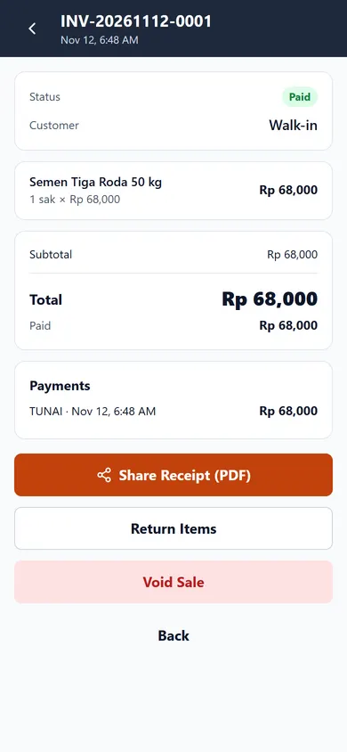

### 10.1 Kartu informasi

- **Status**: Paid / Credit / Void.
- **Customer**: nama pelanggan atau **Walk-in**.
- **Project** (bila diisi).
- **Due date** (bila tempo/DP).

### 10.2 Rincian

- Daftar item: nama, `qty satuan × harga`, subtotal.
- Ringkasan: **Subtotal**, **Discount**, **Tax**, **Delivery fee**, **Rounding**,
  **Total**, **Paid**, **Balance** (bila ada sisa).
- **Payments** — daftar pembayaran (metode · tanggal · jumlah).
- **Returns** — daftar retur (tanggal · kompensasi · nominal minus merah).

### 10.3 Tombol aksi

| Tombol | Muncul bila | Fungsi |
| --- | --- | --- |
| **Share Receipt (PDF)** | Selalu | Buat & bagikan ulang struk PDF |
| **Send Bill via WhatsApp** | Pelanggan punya nomor | Kirim tagihan (nominal sisa/total + jatuh tempo) |
| **Return Items** | Status ≠ Void | Buka sheet retur |
| **Void Sale** | Hanya **Owner**, status ≠ Void | Batalkan transaksi |
| **Back** | Selalu | Kembali |

### 10.4 Retur barang

1. Ketuk **Return Items** → sheet **Return Items**.
2. Pada tiap item, ketuk tombol angka (awal `0`) → numpad **Return qty**.
   Qty retur dibatasi maksimal qty yang dibeli.
3. Pilih **Compensation** *(kompensasi)*:
   - **Refund cash** *(Kembalikan tunai)*.
   - **Deduct receivable** *(Potong piutang)*.
4. Isi **Reason** *(alasan)*, default `Damaged goods` *(barang rusak)*.
5. Tombol **Save Return · Rp {total}** aktif; tanpa item dipilih muncul
   **Select returned items**.
6. Setelah tersimpan: toast **Return saved**, stok barang **masuk kembali** otomatis,
   dan daftar **Returns** di detail diperbarui.

### 10.5 Batal transaksi (Void)

1. Ketuk **Void Sale** (khusus Owner).
2. Dialog **Void Sale?** menjelaskan: stok dikembalikan & nota ditandai VOID,
   tercatat di audit.
3. Ketuk **Void** untuk konfirmasi atau **Cancel**.
4. Hasil: status menjadi **Void**, stok dikembalikan, toast **Sale voided**.
   Nota **tidak bisa** di-void dua kali dan tidak bisa diretur lagi.

> Void tidak dapat dibatalkan. Bila nota sudah sempat **diretur sebagian** lalu di-void,
> stok hasil retur tidak dihitung ulang — periksa stok produk dan koreksi lewat
> **Stock → Count** bila perlu.

---

## 11. Daftar surat jalan (`/pos/delivery`)

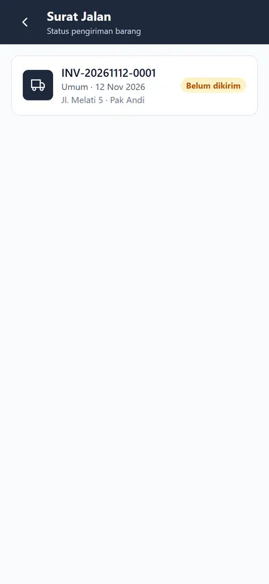

Dibuka dari **More → Delivery Notes** atau tombol **Delivery Notes** di Laporan.

### 11.1 Isi

- AppBar **Delivery Notes** + subjudul **Delivery status**.
- Setiap baris: nomor nota, nama pelanggan (**Walk-in customer** bila kosong),
  tanggal, alamat kirim (atau **No address yet**), dan nama sopir bila ada.

### 11.2 Mengubah status

Tiga chip status pada setiap baris:

| Chip | Arti |
| --- | --- |
| **Pending** | Belum dikirim |
| **On the way** | Dalam perjalanan |
| **Received** | Diterima |

- Ketuk chip yang diinginkan → status langsung tersimpan, toast
  **Status: {status}**.
- Mengetuk status yang sedang aktif tidak melakukan apa-apa.
- Status hanya bisa diubah dari layar ini (tidak ada tombol hapus surat jalan).

Bila belum ada data: **No deliveries yet** + **Create a delivery note from the success screen.**

---

## 12. Produk (`/products`)

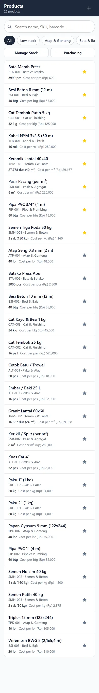

### 12.1 App bar

- **Products** + jumlah produk, mis. **24 products**.
- Tombol **+** (kanan atas) → **New Product** (`/products/new`).

### 12.2 Filter

- Kolom **Search name, SKU, barcode…**.
- Chip **All** — semua produk.
- Chip **Low stock** — hanya produk dengan stok ≤ stok minimum (ketuk lagi untuk mematikan).
- Chip kategori (Semen & Beton, Bata & Batako, dst.) — filter per kategori.

### 12.3 Tombol aksi cepat

- **Manage Stock** → halaman Stok (`/stock`).
- **Purchasing** → halaman Pembelian (`/purchase`).

### 12.4 Daftar produk

Tiap baris menampilkan:

- Nama produk + badge **Low** bila stok ≤ minimum.
- SKU/barcode · kategori.
- Stok format jual, mis. `4 sak (200 kg)`.
- **Cost per {satuan}** (HPP per satuan dasar).
- Ikon **bintang** di kanan: ketuk untuk menandai/membatalkan **Favorite**
  (tidak keluar dari layar).

Ketuk baris (selain bintang) → **Edit Product** (`/products/:id`).

Bila kosong: **No products yet** + tombol **Add Product**.

---

## 13. Tambah / edit produk (`/products/new`, `/products/:id`)

Judul berubah: **New Product** atau **Edit Product**.

### 13.1 Identitas produk

| Field | Keterangan |
| --- | --- |
| **Product Name \*** | Wajib. Contoh: `Semen 50 kg` |
| **SKU** | Kode internal, mis. `SMN-001` |
| **Barcode** | Barcode kemasan, mis. `899...` (bisa dicari di Kasir) |
| **Category** | Dropdown kategori (Semen & Beton, Bata & Batako, Keramik & Lantai, Cat & Finishing, Besi & Baja, Pipa & Plumbing, Kabel & Listrik, Paku & Alat, Pasir & Agregat, Atap & Genteng) |
| **Base unit** | Satuan dasar stok: Kilogram (kg), Sak, Dus, Buah (pcs), Pak, Meter persegi (m²), Meter (m), Meter kubik (m³), Liter (L), Batang (btg), Lembar (lbr), Roll, Kaleng (klg), Pail, Set |

### 13.2 Units & Conversion

- Menampilkan satuan dasar dengan badge **base** (konversi 1, tidak bisa diubah/dihapus).
- Tombol **+ Unit** menambah satuan lain yang belum dipakai.
- Setiap baris: `simbol = [angka konversi] satuan_dasar`.
  Contoh: `sak = 50 kg` berarti 1 sak = 50 kg.
- Ikon **−** menghapus satuan (selain satuan dasar).
- Bila semua satuan sudah dipakai: toast **All units already added**.
- Petunjuk di layar: **Example: 1 sack = 50 kg. Enter the factor to the base unit.**

### 13.3 Selling Price

Untuk **setiap satuan** yang ditambahkan, muncul tiga kolom harga sesuai tier:

- **Eceran** *(Retail)*
- **Grosir** *(Wholesale)*
- **Kontraktor** *(Contractor)*

Harga inilah yang otomatis dipakai di Kasir berdasarkan level harga pelanggan.
Kosongkan bila belum ingin menjual satuan tersebut.

### 13.4 Stock & Cost

| Field | Keterangan |
| --- | --- |
| **Cost per {satuan} (Rp)** | HPP per **satuan dasar** (dipakai untuk laba & nilai stok) |
| **Minimum stock (base unit)** | Batas peringatan stok menipis |
| **Opening stock (base unit)** | Hanya saat produk baru: stok awal yang langsung tercatat sebagai mutasi `STOK_AWAL` |
| **Note** | Catatan internal (opsional) |
| **Show as favorite** | Switch; produk favorit ditandai bintang |
| **Active product** | Switch; matikan untuk menyembunyikan produk dari Kasir |

### 13.5 Tombol bawah

- **Save Product** (baru) / **Save Changes** (edit).
  - Nama kosong → **Product name is required**.
  - Tanpa satuan → **At least one unit**.
  - Sukses → toast **Product added** / **Product updated**, lalu pindah ke halaman edit produk.
- **Delete Product** (hanya saat edit) → dialog **Delete product?**
  dengan penjelasan produk disembunyikan, riwayat penjualan tetap aman.
  Konfirmasi **Delete** → toast **Product deleted**, kembali ke daftar produk.

> Menghapus produk bersifat **soft delete** (disembunyikan), bukan menghapus riwayat.

---

## 14. Stok (`/stock`)

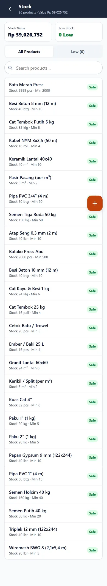

Dibuka dari **Products → Manage Stock**.

### 14.1 Ringkasan atas

- **Stock Value** — total nilai stok (HPP × qty) + subjudul
  `{n} products · Value Rp {v}`.
- **Low Stock** — jumlah produk dengan stok ≤ minimum, berwarna merah bila ada.

### 14.2 Filter

- Segmented: **All Products** / **Low ({n})**.
- Kolom **Search products…**.
- Bila kosong: **No products** + **Change the filter or add products.**

### 14.3 Daftar

Tiap baris: nama produk, `stok format jual · Min {qty} {satuan}`,
badge **Low** (kuning) atau **Out of stock** (merah) bila perlu.

Ketuk baris → sheet **Adjust Stock**.

### 14.4 Sheet Adjust Stock

| Elemen | Fungsi |
| --- | --- |
| **Current stock: {v}** | Stok saat ini (satuan dasar) |
| Segmented **Stock In** / **Stock Out** / **Count** | Jenis mutasi |
| **Quantity ({satuan})** | Jumlah yang dimasukkan |
| Chip **+1**, **+5**, **+10** | Isi cepat (muncul bila stok minimum > 0) |
| **Note** | Catatan, mis. `kiriman supplier` / `barang rusak` |
| **Movement History** | 20 mutasi terakhir: tanggal · tipe · +/− qty |
| **Save Adjustment** | Simpan mutasi |

Arti tipe:

- **Stock In** *(Stok masuk)* — menambah stok (adjustment masuk).
- **Stock Out** *(Stok keluar)* — mengurangi stok (barang rusak/hilang).
- **Count** *(Opname)* — mencatat hasil hitung fisik.

Validasi: qty 0 → **Quantity must be more than 0**. Sukses → toast **Stock updated**,
sheet tertutup. Tipe mutasi tersimpan sebagai `ADJUST_IN`, `ADJUST_OUT`, atau `OPNAME`.

> Qty dihitung dalam **satuan beli default** produk (lihat satuan pada label
> **Quantity ({satuan})**). Contoh: produk dengan satuan beli `sak` → mengisi `2`
> berarti **2 sak** (bukan 2 kg).

---

## 15. Pelanggan & piutang (`/customers`)

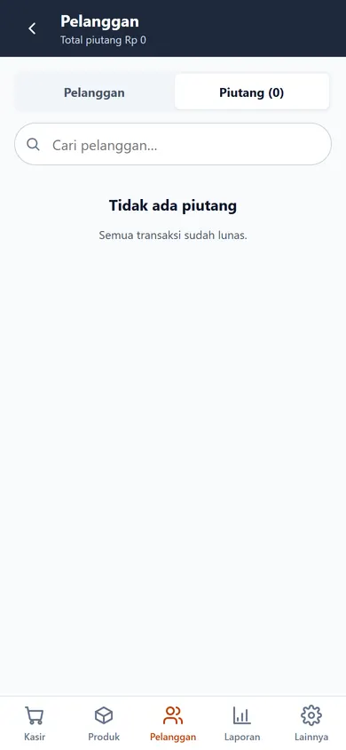

### 15.1 App bar

- **Customers** + subjudul `{n} customers` (tab pelanggan) atau
  `Total receivables Rp {v}` (tab piutang).
- Tombol **+** (hanya di tab Customers) → sheet **New Customer**.

### 15.2 Dua tab

- **Customers** — daftar semua pelanggan.
- **Receivables ({n})** — daftar nota yang belum lunas.

### 15.3 Tab Customers

- Kolom **Search customers…**.
- Baris pelanggan: avatar huruf awal, nama, telepon/alamat
  (atau **Walk-in customer** bila kosong), dan badge **Wholesale** / **Contractor**
  bila level harganya bukan retail.
- Ketuk baris → **Customer detail** (`/customers/:id`).
- Kosong → **No customers yet** + tombol **Add Customer**.

### 15.4 Tambah pelanggan (sheet New Customer)

| Field | Keterangan |
| --- | --- |
| **Name** | Wajib |
| **WA No. / Phone** | Nomor WhatsApp untuk kirim tagihan/struk |
| **Address** | Alamat (dipakai sebagai alamat kirim default) |
| **Project** | Nama proyek/lokasi, mis. `Renovasi Ruko` |
| **Price level** | **Eceran** / **Grosir** / **Kontraktor** — menentukan harga otomatis di Kasir |
| **Credit Limit (Rp)** | `0 = no limit`; hanya peringatan saat kredit melebihi limit |

- Tombol bawah **Save Customer**.
- Nama kosong → peringatan (di versi ini pesan masih berbahasa Indonesia:
  `Nama pelanggan wajib diisi`).
- Sukses → form dikosongkan, sheet tertutup.

### 15.5 Tab Receivables (piutang)

- Bila ada yang telat: kartu merah **{n} overdue notes** + total piutang.
- Baris piutang:
  - Nama pelanggan + **sisa** (merah).
  - Nomor nota · nama proyek.
  - Badge **Overdue {n} days** (merah), **Due {tanggal}** (kuning),
    atau **Credit** (netral).
- Ketuk bagian kiri baris → detail transaksi (`/pos/history/:sale_id`).
- Tombol **Pay** → numpad **Receive Payment**:
  - Nominal awal = sisa piutang; bisa diubah (pembayaran sebagian).
  - Ketuk **Save** → toast **Payment received**, sisa diperbarui.
- Kosong → **No receivables** + **All sales are paid off.**

---

## 16. Detail pelanggan (`/customers/:id`)

### 16.1 Kartu ringkasan

- **Total Receivables** (merah) dan **Total Spent** (total belanja non-void).
- **Project**, **Address**, **Credit limit** (atau **No limit**).

### 16.2 Tombol aksi

| Tombol | Fungsi |
| --- | --- |
| **Edit** | Buka sheet **Edit Customer** |
| **Bill via WA** | Kirim pengingat tagihan ke WhatsApp |
| **New Sale** | Kembali ke Kasir |

**Bill via WA**:

- Tanpa nomor → toast **WhatsApp number not set**.
- Dengan nomor → teks pengingat dibuat (nama, total piutang) lalu WhatsApp dibuka.

### 16.3 Tabs

- **History** — semua transaksi pelanggan; ketuk baris → detail transaksi.
- **Receivables ({n})** — nota belum lunas + tombol **Pay** (numpad yang sama).

### 16.4 Sheet Edit Customer

Field sama seperti tambah pelanggan (Name, WA No./Phone, Address, Project,
Price level, Credit Limit) + tombol **Save**.
Sukses → toast **Customer updated**, sheet tertutup, data langsung berubah.

---

## 17. Pembelian (`/purchase`)

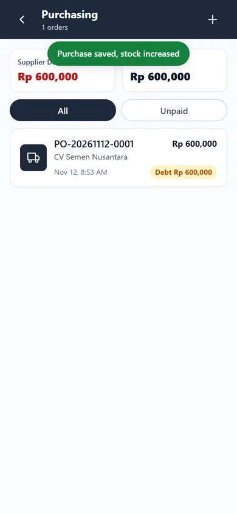

Dibuka dari **More → Purchasing** atau **Products → Purchasing**.

### 17.1 Ringkasan

- **Supplier Debt** — total sisa utang ke supplier (merah bila > 0).
- **Total Purchases** — total nilai seluruh pembelian.
- Subjudul: `{n} orders`.

### 17.2 Filter & tombol

- Chip **All** — semua pembelian.
- Chip **Unpaid** — hanya yang masih ada sisa.
- Tombol **+** (kanan atas) → **New Purchase** (`/purchase/new`).
- Bila kosong: **No purchases yet** + tombol **Record Purchase**.

### 17.3 Daftar

Baris: nomor PO, total, nama supplier, tanggal, badge status:
**LUNAS** (lunas), **BATAL** (batal), atau **Debt Rp {sisa}** (masih ada utang).
Daftar ini hanya untuk melihat; tidak ada tombol edit/hapus pembelian.

---

## 18. Form pembelian (`/purchase/new`)

Judul **New Purchase**, subjudul **Incoming goods from supplier**.

### 18.1 Bagian atas

- **Supplier** — dropdown supplier. Pilihan pertama `Select supplier`.
  Daftar supplier berasal dari data awal aplikasi.
- **Select Items** — buka sheet pencarian produk.

### 18.2 Sheet Select Items

- Kolom **Search name / SKU…**.
- Baris produk: nama, `SKU/barcode/kategori · HPP Rp {nilai}`, badge satuan dasar.
- Ketuk produk → langsung ditambahkan sebagai baris pembelian dengan:
  - satuan **beli default**,
  - qty `1`,
  - harga = HPP × konversi.
- Bila belum ada produk: **No products yet** + **Add products first in the Products menu.**

### 18.3 Item List

Tiap baris:

- Nama produk.
- Harga satuan (biru) — ketuk → numpad **Unit purchase price**.
- Tombol **−** / angka qty / **+** — ubah qty; angka qty bisa diketuk →
  numpad **Purchase quantity**.
- Subtotal + ikon **tempat sampah** untuk menghapus baris.

Kosong → **No items yet. Tap "Select Items".**

### 18.4 Total & pembayaran

| Elemen | Fungsi |
| --- | --- |
| **Total** | Total pembelian |
| **Paid now** + **Edit** | Nominal yang dibayar sekarang (numpad **Paid Now**) |
| Chip **Paid in full** | Isi lunas |
| Chip **All on credit** | Isi 0 (semua utang) |
| Chip **Half** | Isi setengah |
| **Remaining debt** | Sisa utang (merah) |
| Chip **7 hari / 14 / 30 / 60** | Jatuh tempo utang (hanya muncul bila ada sisa) |

### 18.5 Simpan

- Tombol bawah **Save Purchase** (berubah **Saving…**).
- Validasi:
  - Item kosong → **Add at least one item**.
  - Supplier kosong → **Select supplier**.
- Sukses:
  - toast **Purchase saved, stock increased**,
  - **stok bertambah** otomatis sesuai qty × konversi,
  - **HPP produk diperbarui** dari harga beli,
  - kembali ke daftar pembelian.

---

## 19. Kas & shift (`/shift`)

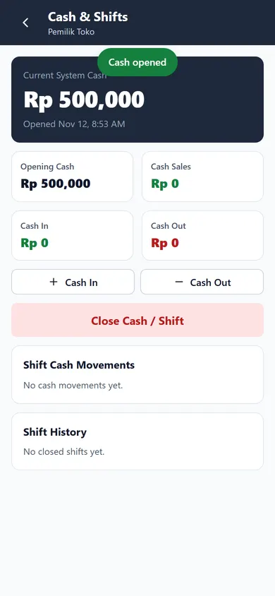

Dibuka dari **More → Cash & Shifts** atau tombol **Cash & Shifts** di Laporan.

### 19.1 Saat kas belum dibuka

- Kartu dengan ikon dompet, judul **Cash not opened yet**
  *(Kas belum dibuka)*, penjelasan singkat.
- Tombol **Open Cash** → sheet **Open Cash**:
  - **Opening Cash / Drawer Fund (Rp)** — modal awal di laci.
  - Chip **No capital** (0), **100.000**, **200.000**, **500.000**, **1.000.000**.
  - Petunjuk: modal awal = uang di laci saat shift mulai.
  - Tombol **Open Cash Now** → toast **Cash opened**.

### 19.2 Saat kas sudah dibuka

Kartu gelap **Current System Cash** menampilkan uang tunai sistem saat ini
dan waktu buka (`Opened {tanggal}`).

Empat KPI:

- **Opening Cash** — modal awal.
- **Cash Sales** — penjualan tunai shift ini.
- **Cash In** — kas masuk manual.
- **Cash Out** — kas keluar manual.

Tombol:

| Tombol | Fungsi |
| --- | --- |
| **+ In** | Buka sheet **In** (kas masuk) |
| **− Out** | Buka sheet **Out** (kas keluar) |
| **Close Cash / Shift** | Buka sheet **Close Cash** |

### 19.3 Sheet kas masuk / keluar

- Segmented **In** / **Out** (bisa ganti di dalam sheet).
- **Amount (Rp)** — nominal.
- **Category**:
  - Masuk: **Operational**, **Extra Capital**, **Receivable Payment**, **Other**.
  - Keluar: **Operational**, **Fuel / Transport**, **Salary**, **Supplies Purchase**,
    **Owner Deposit**, **Other**.
- **Note** — catatan opsional.
- **Save** → toast **Cash movement recorded**. Nominal 0 ditolak:
  **Amount must be more than 0**.

### 19.4 Tutup kas

1. Ketuk **Close Cash / Shift** → sheet **Close Cash**.
2. Sheet menampilkan **System cash** (hitungan sistem).
3. Isi **Counted physical cash (Rp)** — hasil hitung uang fisik di laci
   (otomatis terisi sebesar sistem, silakan koreksi).
4. **Difference** menampilkan selisih (hijau bila lebih, merah bila kurang).
5. Ketuk **Continue Closing** → dialog **Close shift now?**
   berisi ringkasan `System cash …, physical cash …` dan peringatan shift tidak bisa dibuka lagi.
6. Konfirmasi **Close Cash** → toast **Cash closed**.

### 19.5 Riwayat shift

Kartu **Shift History** menampilkan 10 shift tertutup terakhir:
tanggal tutup, **Opening cash {v}**, kas akhir fisik, dan status selisih
(**Exact** / **Over {v}** / **Short {v}**).

> Jika kas belum ditutup, transaksi tetap bisa dilakukan. Penjualan tunai otomatis
> dihitung ke shift yang sedang terbuka. Shift bukan syarat wajib berjualan.

---

## 20. Pengaturan (More) (`/settings`)

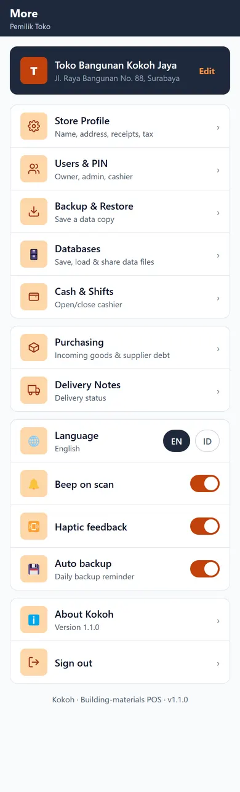

### 20.1 Kartu toko

- Avatar huruf awal toko, **nama toko**, alamat (atau **No address yet**).
- Tombol **Edit** → **Store Profile**.

### 20.2 Grup "Store"

| Baris | Subtitle | Tujuan |
| --- | --- | --- |
| **Store Profile** | Name, address, receipts, tax | `/settings/store` |
| **Users & PIN** | Owner, admin, cashier | `/settings/users` |

### 20.3 Grup "Operations"

| Baris | Tujuan |
| --- | --- |
| **Cash & Shifts** | `/shift` |
| **Purchasing** | `/purchase` |
| **Delivery Notes** | `/pos/delivery` |

### 20.4 Grup "Data & backup"

| Baris | Aksi |
| --- | --- |
| **Backup & Restore** | Buka `/settings/backup` |
| **Databases** | Buka `/settings/databases` |
| **Auto backup** + switch | Menyimpan preferensi pengingat backup di perangkat |

### 20.5 Grup "Preferences"

| Baris | Aksi |
| --- | --- |
| **Language** + chip **EN** / **ID** | Ganti bahasa antarmuka seketika. Mengetuk baris juga mengganti bahasa. |
| **Beep on scan** + switch | Menyimpan preferensi bunyi saat scan barcode |
| **Haptic feedback** + switch | Menyimpan preferensi getaran |

Perubahan bahasa langsung berlaku untuk **label, angka, tanggal, dan format uang**.
Status transaksi (LUNAS/TEMPO/BATAL) tetap memakai kode aslinya.

> Switch **Auto backup**, **Beep on scan**, dan **Haptic feedback** menyimpan preferensi
> di perangkat. Backup tetap harus dijalankan manual lewat **Back Up Now**.

### 20.6 Grup "About"

| Baris | Aksi |
| --- | --- |
| **About Kokoh** + `Version 1.2.0` | Dialog penjelasan aplikasi + tombol **Close** |
| **Sign out** | Dialog **Sign out?** → **Sign out** / **Cancel** |

**Sign out:**

- Menghapus sesi pengguna di perangkat (keranjang tetap tersimpan).
- Toast **Signed out** dan kembali ke `/login`.
- PIN diperlukan untuk masuk lagi.

Footer layar: `Kokoh · Building-materials POS · v1.2.0`.

---

## 21. Profil toko (`/settings/store`)

| Field | Fungsi |
| --- | --- |
| **Store Name \*** | Nama di struk, surat jalan, app bar |
| **Address** | Alamat toko |
| **Phone / WA** | Telepon toko |
| **Receipt Footer** | Teks penutup struk, default `Terima kasih atas kunjungan Anda` |
| **Tax (%)** | Tarif PPN; 0 = tanpa pajak |
| **Rounding (Rp)** | Pembulatan total: **None**, **100**, **500**, **1.000** |

- Tombol **Save** di bawah.
- Nama kosong → **Store name is required**.
- Sukses → toast **Store profile saved**.
- Perubahan pajak/pembulatan langsung memengaruhi perhitungan keranjang berikutnya.

---

## 22. Pengguna & PIN (`/settings/users`)

### 22.1 Daftar pengguna

- AppBar **Users & PIN** + `{n} users`.
- Tombol **+** → sheet **New User**.
- Baris: avatar, nama, role (**Owner** / **Admin** / **Cashier**).
- Pengguna non-Owner punya ikon **tempat sampah**; Owner hanya badge **Owner**.
- Ketuk nama/area teks → sheet **Edit User**.
- Catatan bawah: **Cashiers can sell. Admins manage products & stock. Owners have full access.**

### 22.2 Sheet New/Edit User

| Field | Keterangan |
| --- | --- |
| **Name \*** | Wajib |
| **Role** | **Cashier**, **Admin**, **Owner** |
| **PIN (4-6 digits) \*** | Saat baru wajib; saat edit kosongkan untuk mempertahankan PIN lama |
| **Save** | Simpan |

- Nama kosong → **Name is required**.
- PIN < 4 digit → **PIN must be at least 4 digits**.
- Sukses → toast **User saved**.

### 22.3 Hapus pengguna

1. Ketuk ikon tempat sampah pada baris non-Owner.
2. Dialog **Delete user?** — pengguna tidak bisa login lagi, riwayat tetap.
3. **Delete** → toast **User deleted**.

> Tidak ada fitur "reset PIN Owner" tanpa login. Ganti PIN lewat Edit User
> selama masih bisa masuk sebagai Owner.

---

## 23. Backup & restore (`/settings/backup`)

### 23.1 Back Up Data

- Penjelasan: simpan salinan database, simpan file di tempat aman
  (Google Drive / WhatsApp sendiri).
- Tombol **Back Up Now** (berubah **Working…**) → file `kokoh-backup-YYYY-MM-DD-HH-MM-SS.db`
  disimpan di folder **Documents/backup** perangkat, lalu share sheet Android terbuka
  (opsional untuk langsung mengirim file ke Drive/WhatsApp).
- Teks **Last backup: {tanggal}** atau **Never**.
- Sukses → toast **Backup created**; gagal → **Backup failed: …**

**Cara menyimpan backup yang aman:**

1. Ketuk **Back Up Now**.
2. Pilih **Google Drive** / **WhatsApp** / **Files** pada share sheet.
3. Beri nama file yang memuat tanggal, mis. `kokoh-2026-11-12.db`.
4. Simpan minimal 1 salinan di luar HP.

### 23.2 Restore Data

1. Ketuk **Choose Backup File** → pilih file `.db` dari penyimpanan.
2. Dialog **Restore data?** — semua data saat ini akan diganti.
3. Ketuk **Restore**.
4. Sukses → toast **Data restored**, aplikasi memuat ulang otomatis.
5. Gagal → **Restore failed: …**, data lama tetap dipakai.

### 23.3 Peringatan penting

- Backup rutin adalah satu-satunya perlindungan jika HP hilang/rusak.
- Restore **menimpa seluruh data** (produk, transaksi, pelanggan, pengguna, pengaturan).
- Setelah restore, login bisa berubah mengikuti data di file backup.

---

## 24. Databases (`/settings/databases`)

Manajer banyak file database di perangkat. Berguna untuk arsip bulanan atau
memisahkan data per cabang.

### 24.1 Save Current Database

1. Isi **File name**, mis. `akhir-bulan-nov-2026`.
2. Ketuk **Save Database**.
3. Sukses → toast **Database saved as {nama}**.

### 24.2 Saved Databases

- Daftar file: nama, badge **Active** untuk file yang sedang dipakai,
  ukuran file, dan waktu modifikasi.
- Tombol per baris:
  - **Load** — hanya untuk file non-aktif. Dialog **Load database?** →
    data saat ini diganti, salinan pengaman dibuat lebih dulu, halaman reload.
  - **Share** — bagikan file `.db` lewat share sheet.
  - **Tempat sampah** — dialog **Delete file?** → hapus permanen.
- Kosong → **No saved databases yet**.

### 24.3 Upload Database File

- Tombol **Upload .db File** → pilih file dari Downloads/WhatsApp/Drive.
- File masuk ke daftar, lalu bisa di-**Load**.
- Sukses → toast **Uploaded: {nama}**.

### 24.4 Bahasa

Kartu **Language** dengan tombol **English** / **Bahasa Indonesia** (sama dengan di More).

> **Load** mengganti database aktif. Pastikan sudah backup sebelum memuat file lama.

---

## 25. Alur kerja harian

### 25.1 Pagi — buka toko

1. Buka aplikasi → login PIN.
2. **More → Cash & Shifts → Open Cash** → isi modal laci → **Open Cash Now**.
3. Cek **Products → Low stock** untuk melihat barang yang perlu dibeli.
4. Bila ada kiriman barang → **Purchasing → + → Save Purchase** (stok & HPP otomatis).

### 25.2 Melayani penjualan

1. Tab **Cashier**.
2. Cari produk (nama/kode/barcode) atau pilih kategori.
3. Ketuk produk → pilih satuan → atur qty → **Add**.
4. Bila pelanggan punya harga khusus → **Cart → Select Customer**.
5. Butuh diskon/biaya kirim → **Cart → Receipt discount / Delivery fee**.
6. **Pay** → pilih metode → **Done & Save**.
7. Cetak/kirim struk; bila barang dikirim → **Create Delivery Note**.

### 25.3 Piutang

1. **Customers → Receivables**.
2. Lihat badge **Overdue** dan hubungi pelanggan lewat **Bill via WA**
   (dari detail pelanggan) atau **Send Bill via WhatsApp** (dari detail transaksi).
3. Saat pelanggan membayar → **Pay** → isi nominal → Save.

### 25.4 Sore — tutup toko

1. Hitung uang fisik di laci.
2. **More → Cash & Shifts → Close Cash / Shift**.
3. Masukkan **Counted physical cash** → **Continue Closing** → **Close Cash**.
4. **More → Backup & Restore → Back Up Now** → simpan ke Drive/WhatsApp.
5. Opsional: **More → Databases → Save Database** dengan nama tanggal.

### 25.5 Akhir bulan

1. **Reports → This month** → catat omzet, laba kotor, produk terlaris.
2. **More → Databases** → simpan arsip `akhir-bulan-{bulan}`.
3. **Backup & Restore** → buat file `.db` tambahan di luar HP.
4. Rapikan stok dengan **Stock → Count** untuk produk yang sering selisih.

---

## 26. Peta navigasi lengkap

### 26.1 Diagram alur utama

```text
Splash
  ├─ belum ada toko ──► /setup ──(Start using Kokoh)──► /pos
  └─ ada toko
       ├─ belum login ──► /login ──(PIN benar)──► /pos
       └─ sudah login ──► /pos

/pos (tab)
  ├─ ikon jam ──────────────► /pos/history ──► /pos/history/:id
  ├─ Cart ──────────────────► sheet keranjang
  │    ├─ Select Customer ──► sheet pelanggan
  │    └─ Continue to payment ─► /pos/payment
  ├─ Pay ───────────────────► /pos/payment
  │    └─ Done & Save ──────► /pos/success/:id
  │         ├─ New Sale ────► /pos
  │         ├─ Create Delivery Note ─► sheet surat jalan
  │         └─ View Sale Details ────► /pos/history/:id
  └─ tab lain ──► /products  /customers  /reports  /settings

/products (tab)
  ├─ + ─────────────────────► /products/new
  ├─ baris produk ──────────► /products/:id
  ├─ Manage Stock ──────────► /stock
  └─ Purchasing ────────────► /purchase ──► /purchase/new

/customers (tab)
  ├─ + ─────────────────────► sheet New Customer
  ├─ baris pelanggan ───────► /customers/:id
  └─ tab Receivables ───────► baris ─► /pos/history/:id
                              Pay  ─► numpad pembayaran

/reports (tab)
  ├─ All Transactions ──────► /pos/history
  ├─ Delivery Notes ────────► /pos/delivery
  └─ Cash & Shifts ─────────► /shift

/settings (tab)
  ├─ Store Profile ─────────► /settings/store
  ├─ Users & PIN ───────────► /settings/users
  ├─ Cash & Shifts ─────────► /shift
  ├─ Purchasing ────────────► /purchase
  ├─ Delivery Notes ────────► /pos/delivery
  ├─ Backup & Restore ──────► /settings/backup
  ├─ Databases ─────────────► /settings/databases
  └─ Sign out ──────────────► /login
```

### 26.2 Tabel semua halaman

| Path | Halaman | Cara mencapai |
| --- | --- | --- |
| `/setup` | Setup awal | Otomatis saat database kosong |
| `/login` | Login PIN | Setelah logout / belum login |
| `/pos` | Kasir | Tab **Cashier** |
| `/pos/payment` | Pembayaran | **Pay** atau **Continue to payment** |
| `/pos/success/:id` | Sukses | Setelah **Done & Save** |
| `/pos/history` | Riwayat penjualan | Ikon jam / **All Transactions** |
| `/pos/history/:id` | Detail transaksi | Ketuk baris riwayat / **View Sale Details** |
| `/pos/delivery` | Surat jalan | **More** / **Reports** |
| `/products` | Daftar produk | Tab **Products** |
| `/products/new` | Produk baru | Tombol **+** |
| `/products/:id` | Edit produk | Ketuk baris produk |
| `/stock` | Stok | **Manage Stock** |
| `/customers` | Pelanggan | Tab **Customers** |
| `/customers/:id` | Detail pelanggan | Ketuk baris pelanggan |
| `/purchase` | Pembelian | **More** / **Products** |
| `/purchase/new` | Pembelian baru | Tombol **+** |
| `/reports` | Laporan | Tab **Reports** |
| `/settings` | More | Tab **More** |
| `/settings/store` | Profil toko | **Store Profile** / **Edit** |
| `/settings/users` | Pengguna | **Users & PIN** |
| `/settings/backup` | Backup | **Backup & Restore** |
| `/settings/databases` | Databases | **Databases** |
| `/shift` | Kas & shift | **Cash & Shifts** |

---

## 27. Daftar tombol per layar

Ringkasan cepat untuk pelatihan kasir.

### Kasir & penjualan

| Layar | Tombol | Hasil |
| --- | --- | --- |
| Kasir | Ikon jam | Riwayat penjualan |
| Kasir | **Grid** / **List** | Ganti tampilan katalog |
| Kasir | Chip **All** / kategori | Filter produk |
| Kasir | Kartu produk | Buka sheet produk |
| Sheet produk | Chip satuan | Ganti satuan jual |
| Sheet produk | **−** / **+** | Ubah qty |
| Sheet produk | Angka qty | Numpad qty |
| Sheet produk | **Add · Rp …** | Masuk keranjang |
| Footer | **Cart** | Buka keranjang |
| Footer | **Pay** | Halaman pembayaran |
| Keranjang | **Clear** | Kosongkan keranjang |
| Keranjang | **Select Customer** | Pilih pelanggan |
| Keranjang | **−** / **+** / qty | Ubah jumlah |
| Keranjang | Ikon sampah | Hapus baris |
| Keranjang | **Receipt discount** | Diskon nota |
| Keranjang | **Delivery fee** | Biaya kirim |
| Keranjang | **Continue to payment** | Ke pembayaran |
| Pembayaran | **Cash/Transfer/Credit/Deposit** | Pilih metode |
| Pembayaran | **Edit** | Ubah nominal |
| Pembayaran | **Exact** / chip Rp | Isi cepat |
| Pembayaran | **Select Customer \*** | Pilih pelanggan |
| Pembayaran | Chip 7/14/30/60 hari | Jatuh tempo |
| Pembayaran | Chip 25/50/75% | Nominal DP |
| Pembayaran | **Done & Save** | Simpan transaksi |
| Sukses | **New Sale** | Kasir baru |
| Sukses | **Print / Share Receipt (PDF)** | PDF struk |
| Sukses | **Send to WhatsApp** | Kirim struk |
| Sukses | **Create Delivery Note** | Sheet surat jalan |
| Sukses | **View Sale Details** | Detail transaksi |

### Riwayat & detail

| Layar | Tombol | Hasil |
| --- | --- | --- |
| Riwayat | Kolom pencarian | Cari nota/pelanggan |
| Riwayat | **All / Paid / Credit / Void** | Filter status |
| Riwayat | Baris transaksi | Detail |
| Detail | **Share Receipt (PDF)** | Bagikan struk |
| Detail | **Send Bill via WhatsApp** | Kirim tagihan |
| Detail | **Return Items** | Sheet retur |
| Detail | **Void Sale** | Batalkan (Owner) |
| Detail | **Back** | Kembali |
| Retur | Angka qty | Numpad qty retur |
| Retur | **Refund cash / Deduct receivable** | Kompensasi |
| Retur | **Save Return · Rp …** | Simpan retur |
| Surat jalan | **Pending / On the way / Received** | Ubah status |

### Produk & stok

| Layar | Tombol | Hasil |
| --- | --- | --- |
| Produk | **+** | Produk baru |
| Produk | **Low stock** | Filter stok menipis |
| Produk | Bintang | Favorit |
| Produk | **Manage Stock** | Halaman stok |
| Produk | **Purchasing** | Halaman pembelian |
| Form produk | **+ Unit** | Tambah satuan |
| Form produk | **−** | Hapus satuan |
| Form produk | Switch favorite/active | Tandai favorit / aktif |
| Form produk | **Save Product / Save Changes** | Simpan |
| Form produk | **Delete Product** | Hapus (soft) |
| Stok | **All Products / Low** | Filter |
| Stok | Baris produk | Sheet adjustment |
| Stok | **Stock In / Stock Out / Count** | Jenis mutasi |
| Stok | **+1 / +5 / +10** | Isi cepat |
| Stok | **Save Adjustment** | Simpan mutasi |

### Pelanggan & pembelian

| Layar | Tombol | Hasil |
| --- | --- | --- |
| Pelanggan | **+** | Tambah pelanggan |
| Pelanggan | **Customers / Receivables** | Ganti tab |
| Pelanggan | **Pay** | Numpad pembayaran |
| Pelanggan | Baris pelanggan | Detail |
| Detail pelanggan | **Edit** | Sheet edit |
| Detail pelanggan | **Bill via WA** | Pengingat WA |
| Detail pelanggan | **New Sale** | Ke kasir |
| Detail pelanggan | **History / Receivables** | Ganti tab |
| Pembelian | **+** | Pembelian baru |
| Pembelian | **All / Unpaid** | Filter |
| Pembelian | **Select Items** | Pilih produk |
| Pembelian | **Paid in full / All on credit / Half** | Isi cepat pembayaran |
| Pembelian | Chip 7/14/30/60 hari | Jatuh tempo utang |
| Pembelian | **Save Purchase** | Simpan |

### Kas, laporan, pengaturan

| Layar | Tombol | Hasil |
| --- | --- | --- |
| Kas | **Open Cash** | Sheet modal awal |
| Kas | **Open Cash Now** | Buka shift |
| Kas | **+ In / − Out** | Kas masuk/keluar |
| Kas | **Close Cash / Shift** | Sheet tutup kas |
| Kas | **Continue Closing** | Dialog konfirmasi |
| Laporan | **Today / Yesterday / 7 days / This month** | Periode |
| Laporan | **All Transactions** | Riwayat |
| Laporan | **Delivery Notes** | Surat jalan |
| Laporan | **Cash & Shifts** | Shift |
| More | **Store Profile** | Profil toko |
| More | **Users & PIN** | Pengguna |
| More | **Backup & Restore** | Backup |
| More | **Databases** | File database |
| More | **EN / ID** | Ganti bahasa |
| More | Switch auto backup/sound/haptic | Preferensi |
| More | **About Kokoh** | Info versi |
| More | **Sign out** | Keluar |
| Profil toko | **Save** | Simpan profil |
| Pengguna | **+** | Pengguna baru |
| Pengguna | Baris pengguna | Edit |
| Pengguna | Ikon sampah | Hapus |
| Backup | **Back Up Now** | Buat backup |
| Backup | **Choose Backup File** | Restore |
| Databases | **Save Database** | Simpan salinan |
| Databases | **Load / Share / sampah** | Muat/bagikan/hapus |
| Databases | **Upload .db File** | Impor file |

---

## 28. Troubleshooting & FAQ

### Aplikasi lama dibuka / layar putih

1. Tutup paksa aplikasi (swipe dari recent apps).
2. Buka lagi; splash akan memuat ulang database.
3. Jika tetap **Failed to load app**, restore backup terakhir:
   buka aplikasi → bila tidak bisa masuk, pasang ulang APK → `/setup` → restore dari
   **Backup & Restore** (file `.db` yang tersimpan di Drive/WhatsApp).

### "Wrong PIN" padahal PIN benar

- Pastikan **nama pengguna yang dipilih** benar (chip di atas numpad).
- PIN bisa 4–6 digit; bila akun lain punya PIN yang sama, pilih akun yang tepat.
- Bila PIN benar-benar lupa, minta Owner menggantinya di **Users & PIN**.

### Stok minus / tidak sesuai

- Penjualan tidak diblokir saat stok habis, jadi stok bisa minus.
- Koreksi lewat **Stock → pilih produk → Count** (opname) atau **Stock In/Out**.
- Cek **Movement History** untuk melihat mutasi terakhir.

### Harga di Kasir tidak sesuai

- Harga mengikuti **Price level pelanggan** (Eceran/Grosir/Kontraktor).
- Periksa harga tier di **Products → Edit Product → Selling Price**.
- Pelanggan tanpa level khusus memakai **Eceran**.

### Total berbeda dari hitungan manual

Urutan: subtotal → diskon nota → PPN → biaya kirim → pembulatan.
Periksa **Tax (%)** dan **Rounding** di **Store Profile**, serta diskon/biaya kirim di keranjang.

### Nota tidak bisa di-void

- **Void Sale** hanya untuk **Owner**.
- Nota yang sudah **Void** tidak bisa di-void lagi.
- Nota yang sudah diretur sebagian masih bisa di-void; stok penyesuaian mengikuti.

### Surat jalan tidak muncul di daftar

- Surat jalan dibuat dari layar **sukses** lewat **Create Delivery Note**, bukan dari Kasir.
- Pastikan tombol **Print / Share Delivery Note** ditekan (bukan hanya menutup sheet).

### Pesan WhatsApp tidak terbuka

- Pastikan pelanggan punya nomor **WA No. / Phone**.
- WhatsApp harus terpasang di HP. Bila tidak ada, gunakan **Print / Share Receipt (PDF)**
  lalu kirim manual.
- Nomor sebaiknya format lokal `08…` atau internasional `628…`.

### Backup gagal

- Pastikan ruang penyimpanan cukup.
- Coba bagikan ke **Files** dulu, lalu unggah manual ke Drive.
- Jangan menutup aplikasi saat proses **Working…** berjalan.

### Data hilang setelah ganti HP

Data **tidak** pindah otomatis. Pindahkan dengan:
**Back Up Now** di HP lama → salin file `.db` → di HP baru buka **Backup & Restore →
Choose Backup File** → **Restore**.
Alternatif: **Databases → Save Database → Share**, lalu **Upload .db File** di HP baru.

### Bahasa berubah sendiri?

Bahasa tersimpan per perangkat. Cek **More → Language** (chip **EN**/**ID**).
Mengubah bahasa juga mengubah format angka, tanggal, dan uang, bukan hanya label.

### Bagaimana menambah kategori atau supplier?

Pada v1.2.0 kategori dan supplier berasal dari data awal aplikasi dan **belum ada**
layar khusus untuk menambah/mengubahnya. Produk tetap bisa dipilih kategorinya
dari daftar yang tersedia.

### Apakah butuh internet?

Tidak. Internet hanya dipakai saat membuka tautan WhatsApp atau share sheet
(Drive/WhatsApp). Semua transaksi, stok, dan laporan berjalan offline.

### Apakah data aman jika aplikasi di-uninstall?

Tidak. Uninstall menghapus database lokal. **Selalu backup** sebelum uninstall,
ganti HP, atau reset perangkat.

---

## 29. Tips & praktik terbaik

1. **Backup setiap tutup toko.** Satu file `.db` per hari, simpan di luar HP.
2. **Isi HPP dengan benar.** Laba kotor dan nilai stok bergantung pada HPP per satuan dasar.
3. **Gunakan satuan dasar terkecil** (kg, m², pcs) agar konversi sak/dus/pak mudah diatur.
4. **Atur stok minimum** per produk supaya badge **Low stock** berguna.
5. **Manfaatkan price level.** Buat pelanggan kontraktor dengan harga khusus, grosir untuk
   toko/langganan, retail untuk walk-in.
6. **Pakai proyek pada pelanggan** agar nota mudah dicari dan surat jalan jelas tujuannya.
7. **Biasakan buka/tutup kas** supaya selisih uang harian terdeteksi.
8. **Jangan mengubah harga di keranjang** untuk menghindari salah hitung; nego harga
   dilakukan di sheet produk atau lewat tier harga.
9. **Cek laporan mingguan** untuk melihat produk terlaris dan omzet per hari.
10. **Simpan arsip bulanan** lewat **Databases** sebelum mengganti data atau melakukan
    opname besar.

---

## Lampiran — Peran pengguna & hak akses

| Kemampuan | Cashier | Admin | Owner |
| --- | --- | --- | --- |
| Jual barang (Kasir) | ✔ | ✔ | ✔ |
| Lihat riwayat & laporan | ✔ | ✔ | ✔ |
| Kelola produk & stok | ✔ | ✔ | ✔ |
| Kelola pembelian | ✔ | ✔ | ✔ |
| Kelola pelanggan & piutang | ✔ | ✔ | ✔ |
| Kas & shift | ✔ | ✔ | ✔ |
| Backup / databases | ✔ | ✔ | ✔ |
| Pengaturan toko & pengguna | ✔ | ✔ | ✔ |
| Hapus pengguna non-Owner | ✔ | ✔ | ✔ |
| **Void transaksi** | — | — | ✔ |

> **Penting:** pada v1.2.0 pembatasan yang benar-benar ditegakkan di antarmuka hanya
> **Void Sale** (hanya Owner). Role **Cashier/Admin/Owner** saat ini lebih berfungsi
> sebagai label organisasi; semua pengguna yang bisa login tetap dapat membuka menu
> operasional dan pengaturan. Gunakan PIN yang berbeda per pengguna agar jejak
> transaksi (kasir pada nota) tetap jelas.

---

**Versi dokumen:** 1.2.0 (versionCode 5)
**Aplikasi:** Kokoh App Bangunan · `id.aksisoft.kokoh`
**Bahasa default:** English · tersedia Bahasa Indonesia
**Mode:** 100% offline
